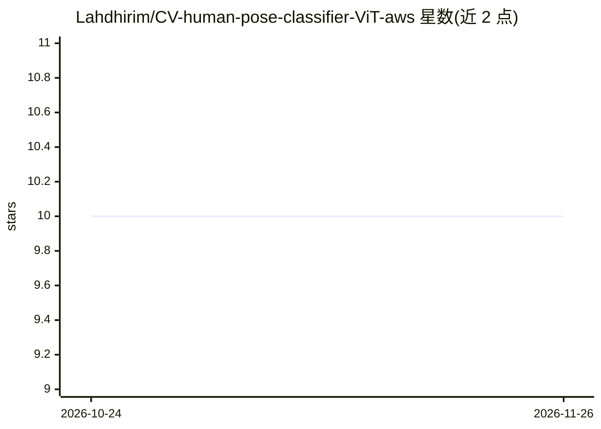

# Lahdhirim/CV-human-pose-classifier-ViT-aws

⭐ 10 · Python · MIT · 推送 2026-02-21 · [GitHub](https://github.com/Lahdhirim/CV-human-pose-classifier-ViT-aws) · [官网](https://cv-human-pose-classifier-vit-aws-c.streamlit.app/) · 个人维护

**基于 ViT 的人体姿态动作分类流水线，含 AWS 部署**

端到端图像分类项目：从 Hugging Face 加载 Bingsu/Human_Action_Recognition 数据集，对 google/vit-base-patch16-224 进行微调，将图像分为 15 类动作（准确率 0.796）。预处理、训练、测试三个阶段均通过 JSON 配置文件驱动；测试达到指标阈值时经 boto3 自动上传模型至 S3，可在 EC2 上部署，通过 FastAPI 后端与 Streamlit 前端进行在线推理。提供 Streamlit 在线 demo，部署依赖 AWS IAM/S3/EC2 配置。

## 筛选速览

| 维度 | 判定 | 备注 |
|---|---|---|
| AI 角色 | `ai-native` | 本体是模型或模型工具 |
| 许可风险 | `permissive` | MIT |
| 部署形态 | `self-host` | docker 或自建部署 |
| 模型依赖 | — | README 未给出锁定关系 |
| 硬件要求 | — | 无带数字的原话,不猜 |
| 安装摩擦 | `low` | 无编译、无系统依赖或容器化 |
| 成熟度 | — | 结构信号不足 |

## 能力要点

- ViT 微调分类 15 类人体动作，冻结层数等训练参数可配置
- 预处理/训练/测试三流水线由 JSON 配置驱动，无需改代码
- 测试指标达阈值后自动经 boto3 推送模型至 S3
- FastAPI 后端 + Streamlit 前端在线推理，提供线上 demo

## 适用场景

- 对含人体动作的图像做 15 类动作分类
- 复用 JSON 配置流水线在自己的数据集上微调 ViT
- 在 AWS EC2/S3 上部署和管理训练好的模型

## 场景标签

`目标检测` `微调` `MLOps` · 领域:感知与多模态

## 证据(README 行号)

> L3: This project implements a **human pose classifier** using Visual Transformers (ViT), covering all required steps fro
> L20: - **Model Architecture**: A **Vision Transformer (ViT)** fine-tuned to classify images into 15 action categories, s
> L23: - **Web Interface**: Interactive inference via **FastAPI** backend and **Streamlit** frontend.

## 星数曲线

2026-10-24 10 → 2026-11-26 10（+0）

---
*卡片 v1 · prompt 1.4 · 生成 2026-11-20 · 置信度 mid · 依据 README sha `429572dd5a8b` · [字段定义](../../DATASET.md)*
