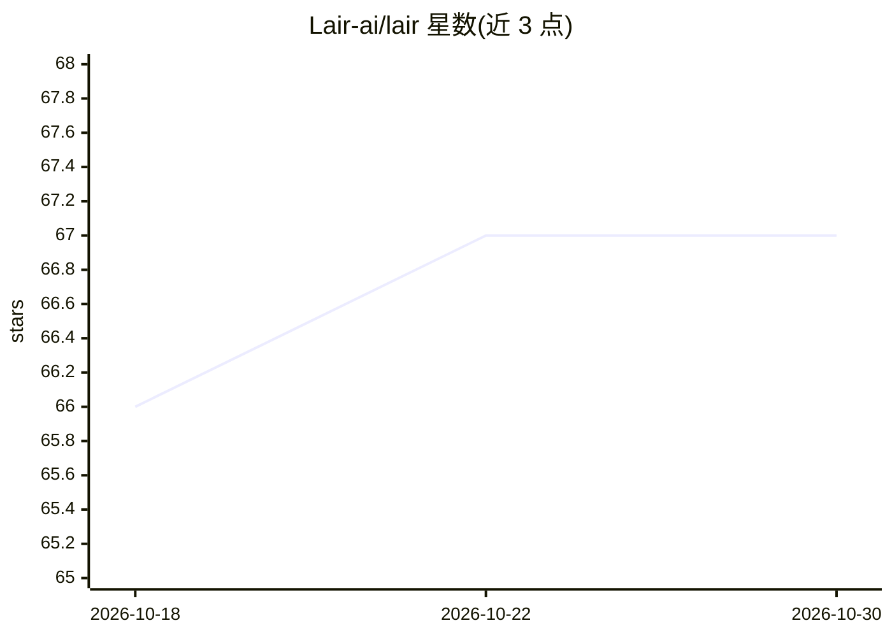

# Lair-ai/lair

⭐ 67 · Shell · GPL-3.0 · 推送 2026-10-27 · [GitHub](https://github.com/Lair-ai/lair) · [官网](https://dev.lair-ai.it) · 组织维护

**自托管的私有 AI 基础设施平台：Kubernetes 上一键部署完整 AI 栈**

由 NEXiD s.r.l. 开发的企业级私有 AI 部署平台：通过交互式 setup.sh 向导在自有服务器上搭建 MicroK8s 或对接托管 Kubernetes（EKS/GKE/AKS/OVH MKS），并以 Helm Chart 编排 OpenWebUI（类 ChatGPT 界面+RAG）、Ollama 本地模型服务、N8N 工作流自动化（400+ 集成）、ComfyUI 图像生成、Tika 文档处理及 MinIO/PostgreSQL/Redis 等组件。支持 NVIDIA Jetson/DGX Spark 边缘部署与 ARM64/x86_64 平台检测；无 GPU 时可接外部 LLM 提供商（建议欧洲 GDPR 合规服务商）。最低 8 GB 内存但需禁用本地模型与图像生成。

## 筛选速览

| 维度 | 判定 | 备注 |
|---|---|---|
| AI 角色 | `ai-ecosystem` | LLM/agent 周边工具 |
| 许可风险 | `viral` | GPL-3.0 |
| 部署形态 | `None` |  |
| 模型依赖 | local-ok | 支持本地模型 |
| 硬件要求 | — | 无带数字的原话,不猜 |
| 安装摩擦 | `medium` | 含编译或系统依赖之一 |
| 成熟度 | — | 结构信号不足 |

## 能力要点

- 一条 setup.sh 向导完成集群搭建与 Helm 应用部署
- 组件覆盖 OpenWebUI/Ollama/N8N/ComfyUI/Tika/MinIO 等，可按需启停
- 支持 MicroK8s 单/多节点、托管 K8s、Jetson 与 DGX Spark（验证可跑 70B FP16 模型）
- Velero 自动备份到 S3 兼容存储，SSO 支持 Azure AD/Google/OIDC

## 适用场景

- 医疗、金融、政务等敏感数据组织在自有基础设施上使用 AI
- 在 Kubernetes 集群上搭建带 RAG 与工作流自动化的私有 AI 平台
- 边缘或内网环境（DGX Spark、Jetson、局域网）部署完全离线的 AI 服务

## 场景标签

`工作流自动化` `图像生成` `RAG` `聊天机器人` · 领域:效率与自动化

## 证据(README 行号)

> L19: Lair enables organizations to deploy **private AI infrastructure** with comprehensive **process automation capabili
> L38: - **A private ChatGPT** — A web interface (OpenWebUI) where your team can chat with AI, upload documents, search kn
> L103: |**Ollama**|Local LLM serving platform|Internal API|

## 星数曲线

2026-10-18 66 → 2026-10-30 67（+1）

---
*卡片 v1 · prompt 1.4 · 生成 2026-10-24 · 置信度 high · 依据 README sha `f470f4e3d847` · [字段定义](../../DATASET.md)*
