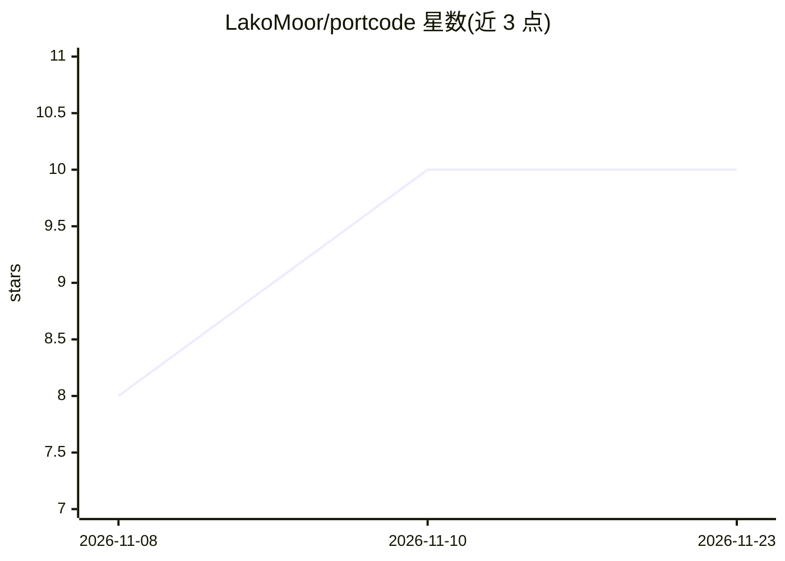

# LakoMoor/portcode

⭐ 10 · Rust · NOASSERTION · 推送 2026-11-20 · [GitHub](https://github.com/LakoMoor/portcode) · [官网](https://lakomoor.github.io/portcode/) · 个人维护

**本地 LLM 驱动的终端 Agent：逆向程序并移植为 Rust 且验证等价**

开源终端 Agent，针对一个程序做三步流程：先钉住原始构建的 sha256 并以 append-only 证据账本记录事实，再逐片改写为 Rust 并对照从原程序捕获的 golden 输出，最后用 parity（数值容差、PNG diff）、差分模糊测试与逐功能终端截图验证。默认 clean-room 模式仅从外部运行观察，deep 模式接入 Capstone、Unicorn、Kuna 反编译器等引擎做反汇编与反编译。面向需要逆向分析与 Rust 移植、且希望在本地/自托管模型上运行的工程师。限制：Alpha 阶段，尚未对具体 DeepSeek/Qwen 版本做端到端基准测试。

## 筛选速览

| 维度 | 判定 | 备注 |
|---|---|---|
| AI 角色 | `ai-native` | 本体是模型或模型工具 |
| 许可风险 | `none` | NOASSERTION |
| 部署形态 | `desktop` | 安装包/桌面程序 |
| 模型依赖 | local-ok | 支持本地模型 |
| 硬件要求 | — | 无带数字的原话,不猜 |
| 安装摩擦 | `medium` | 含编译或系统依赖之一 |
| 成熟度 | `idea` | |

## 能力要点

- 完成需通过三项检查（行为全覆盖 todo、全部完成、最终代码 parity 通过），否则打回续做
- 证据账本按 observation/inference/unknown 记录，生成含计划、证据、截图的 GitHub Pages 站点
- 支持任意 OpenAI 兼容 /v1/chat/completions 工具调用端点，内置 DeepSeek/Qwen 模型 profile
- portcode serve 可从浏览器/手机远程驱动会话，经自选隧道直连本机并以 HMAC 挑战认证

## 适用场景

- 把一个旧程序逐行为移植为 Rust 并证明行为一致
- 在本地模型上对自有软件做反汇编、反编译等深度逆向分析
- 严格净室流程：先写 SPEC 与账本，再仅凭文档重写实现
- 通过浏览器或手机远程查看并控制本机上的 Agent 会话

## 场景标签

`编码 Agent` · 领域:编码与开发

## 证据(README 行号)

> L3: An open-source terminal agent that studies a program, rewrites it in Rust and compares the result with the original.
> L99: Any OpenAI-compatible `/v1/chat/completions` endpoint with tool calling. Open-weight quirks are absorbed by the cli

## 星数曲线

2026-11-08 8 → 2026-11-23 10（+2）

---
*卡片 v1 · prompt 1.4 · 生成 2026-11-20 · 置信度 high · 依据 README sha `d41fa7e73cca` · [字段定义](../../DATASET.md)*
