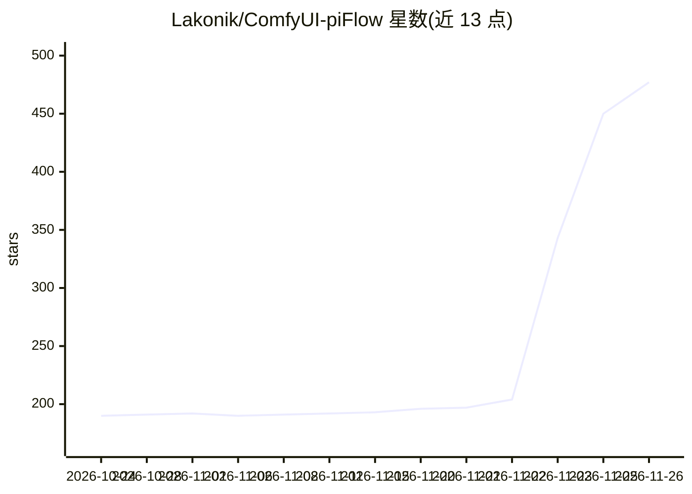

# Lakonik/ComfyUI-piFlow

⭐ 477 · Python · Apache-2.0 · 推送 2026-11-23 · [GitHub](https://github.com/Lakonik/ComfyUI-piFlow) · [官网](https://github.com/Lakonik/LakonLab) · 个人维护

**为 ComfyUI 提供 pi-H3/AsymFlow/pi-Flow 生成模型节点**

ComfyUI 的自定义节点集合，实现 pi-H3、AsymFlow、pi-Flow 三个模型家族：pi-H3 面向 MiniMax H3 的 2–4 步快速生成且无需 VAE 解码器，AsymFlow 在像素空间生成真实感图像，pi-Flow 提供少步数快速生成，各模型均附带工作流。需 ComfyUI 0.45.0 及以上版本，安装前要求卸载非官方的同类扩展，通过 git clone 到 custom_nodes 目录安装。

## 筛选速览

| 维度 | 判定 | 备注 |
|---|---|---|
| AI 角色 | `ai-native` | 本体是模型或模型工具 |
| 许可风险 | `permissive` | Apache-2.0 |
| 部署形态 | `None` |  |
| 模型依赖 | — | README 未给出锁定关系 |
| 硬件要求 | — | 无带数字的原话,不猜 |
| 安装摩擦 | `low` | 无编译、无系统依赖或容器化 |
| 成熟度 | — | 结构信号不足 |

## 能力要点

- 实现 pi-H3、AsymFlow、pi-Flow 三个模型家族的 ComfyUI 节点
- pi-H3 支持 2–4 步生成且无需 VAE 解码器
- 每个模型家族附带动手工作流

## 适用场景

- 在 ComfyUI 中用 pi-H3 少步快速生成图像
- 用 AsymFlow 在像素空间生成真实感图像
- 用 pi-Flow 进行少步数快速生成

## 场景标签

`图像生成` · 领域:内容生成

## 证据(README 行号)

> L3: **ComfyUI-piFlow** is a collection of custom nodes for ComfyUI that implement the following model families:
> L24: **This extension requires ComfyUI version 0.45.0 or higher**. Older ComfyUI releases are no longer supported.

## 星数曲线

2026-10-24 190 → 2026-11-26 477（+287）

---
*卡片 v1 · prompt 1.4 · 生成 2026-11-25 · 置信度 high · 依据 README sha `e63bae52fc9b` · [字段定义](../../DATASET.md)*
