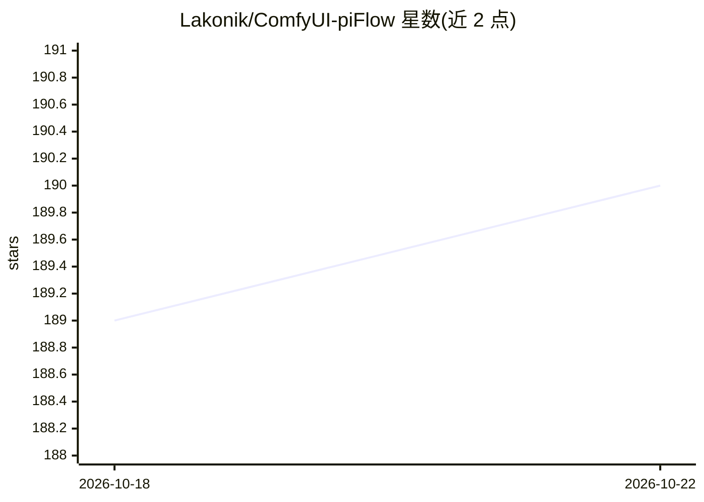

# Lakonik/ComfyUI-piFlow

⭐ 190 · Python · Apache-2.0 · 推送 2026-09-03 · [GitHub](https://github.com/Lakonik/ComfyUI-piFlow) · [官网](https://github.com/Lakonik/LakonLab) · 个人维护

**ComfyUI 自定义节点集：实现 AsymFlow 与 pi-Flow 图像生成模型**

为 ComfyUI 提供自定义节点集合，实现 AsymFlow 与 pi-Flow 两个模型系列：前者在像素空间生成写实图像，后者支持少步数快速生成。要求 ComfyUI 0.23.0 及以上版本，并需先卸载非官方的同名扩展以避免兼容问题。安装途径包括通过 ComfyUI Manager 安装缺失节点，或手动 git clone 到 custom_nodes 目录。仓库以 Apache-2.0 许可，模型本身遵循各自许可。

## 筛选速览

| 维度 | 判定 | 备注 |
|---|---|---|
| AI 角色 | `ai-ecosystem` | LLM/agent 周边工具 |
| 许可风险 | `permissive` | Apache-2.0 |
| 部署形态 | `None` |  |
| 模型依赖 | — | README 未给出锁定关系 |
| 硬件要求 | — | 无带数字的原话,不猜 |
| 安装摩擦 | `low` | 无编译、无系统依赖或容器化 |
| 成熟度 | — | 结构信号不足 |

## 能力要点

- AsymFlow：像素空间生成写实图像
- pi-Flow：少步数快速生成
- 支持 ComfyUI Manager 一键补装缺失节点
- 提供示例工作流（Workflows）

## 适用场景

- 在 ComfyUI 中运行 AsymFlow / pi-Flow 模型生成图像
- 用少步数采样快速出图
- 通过工作流文件直接加载并补装所需节点

## 场景标签

`图像生成` · 领域:内容生成

## 证据(README 行号)

> L3: **ComfyUI-piFlow** is a collection of custom nodes for ComfyUI that implement the following model families:
> L18: **This extension requires ComfyUI version 0.23.0 or higher**. Older ComfyUI releases are no longer supported.

## 星数曲线

2026-10-18 189 → 2026-10-22 190（+1）

---
*卡片 v1 · prompt 1.4 · 生成 2026-10-22 · 置信度 high · 依据 README sha `ced86270330d` · [字段定义](../../DATASET.md)*
