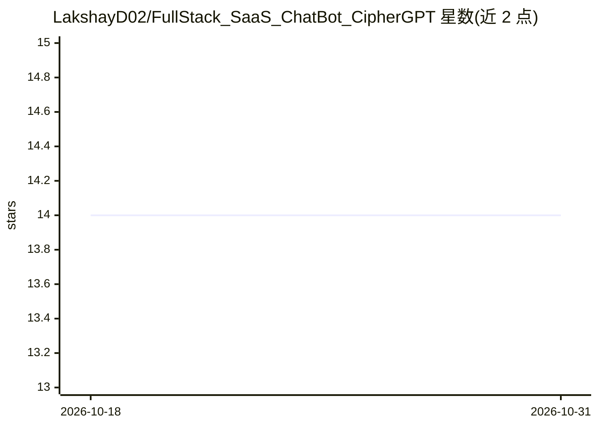

# LakshayD02/FullStack_SaaS_ChatBot_CipherGPT

⭐ 14 · TypeScript · 推送 2026-08-20 · [GitHub](https://github.com/LakshayD02/FullStack_SaaS_ChatBot_CipherGPT) · [官网](https://ciphergpt-lakshay.vercel.app/) · 个人维护

**MERN 全栈 SaaS AI 聊天平台，面向开发者与重度用户**

基于 MongoDB、Express、React、Node.js 与 TypeScript 构建的 SaaS 聊天机器人工作区：提供多会话线程管理、流式逐字输出、中途取消响应（AbortController）、浏览器内 PDF 解析（pdfjs-dist）、OTP 账户恢复、明暗主题切换等功能。AI 部分通过 OpenRouter SDK 接入免费模型池（openrouter/free）实现自动故障转移。本地运行需 Node.js v18+、MongoDB 与 OpenRouter API key，前后端分别以 npm 启动开发服务器，并附生产部署指引（Vercel/Render 等）。

## 筛选速览

| 维度 | 判定 | 备注 |
|---|---|---|
| AI 角色 | `ai-native` | 本体是模型或模型工具 |
| 许可风险 | `none` | — |
| 部署形态 | `library` | 以包/库形式分发 |
| 模型依赖 | locked-api |  |
| 硬件要求 | — | 无带数字的原话,不猜 |
| 安装摩擦 | `low` | 无编译、无系统依赖或容器化 |
| 成熟度 | — | 结构信号不足 |

## 能力要点

- 多会话聊天线程管理与可折叠响应式侧边栏
- OpenRouter SDK 接入免费模型池，自动故障转移
- 浏览器端 PDF 文本提取与图片预览
- 实时中止生成与流式逐字输出动画

## 适用场景

- 部署一个可自托管的 AI 对话 SaaS 应用
- 在写作或开发工作中使用多线程对话管理上下文
- 基于其结构二次开发带认证的聊天产品

## 场景标签

`聊天机器人` · 领域:对话与助手

## 证据(README 行号)

> L3: A premium, state-of-the-art AI chatbot workspace designed for developers, writers, and power users. Built with clean
> L23: - **AI Integrations**: OpenRouter SDK (Auto-failover free router model pool via `openrouter/free`)

## 星数曲线

2026-10-18 14 → 2026-10-31 14（+0）

---
*卡片 v1 · prompt 1.4 · 生成 2026-10-31 · 置信度 high · 依据 README sha `396ddb589bc4` · [字段定义](../../DATASET.md)*
