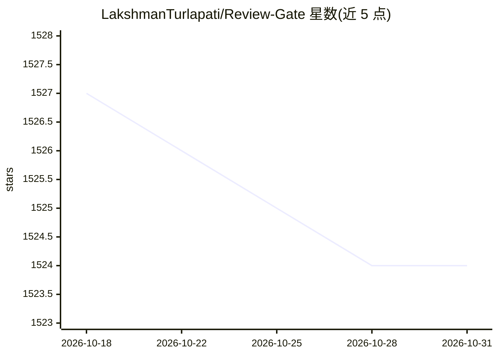

# LakshmanTurlapati/Review-Gate

⭐ 1,524 · JavaScript · 推送 2026-04-02 · [GitHub](https://github.com/LakshmanTurlapati/Review-Gate) · [官网](https://www.youtube.com/watch?v=mZmNM-AIf4M) · 个人维护

**Cursor IDE 的交互式审查规则与 MCP 工具，让 Agent 在单次请求内循环待命**

面向 Cursor IDE 用户的工作流控制扩展：通过规则文件与本地 MCP 服务器（review_gate_chat 工具）在 AI 完成主任务后弹出交互窗口，支持文本、语音（本地 Faster-Whisper 转录）与图片上传输入后续指令，直到用户输入 TASK_COMPLETE 才结束该主请求，从而在单次请求的工具调用额度内完成迭代式工作。提供 macOS/Windows/Linux 一键安装脚本，语音功能需系统支持 Python 3 与 SoX；Windows/Linux 语音路径相对 macOS 成熟度低，作者标注为实验性。

## 筛选速览

| 维度 | 判定 | 备注 |
|---|---|---|
| AI 角色 | `ai-ecosystem` | LLM/agent 周边工具 |
| 许可风险 | `none` | — |
| 部署形态 | `None` |  |
| 模型依赖 | — | README 未给出锁定关系 |
| 硬件要求 | — | 无带数字的原话,不猜 |
| 安装摩擦 | `low` | 无编译、无系统依赖或容器化 |
| 成熟度 | `idea` | |

## 能力要点

- 规则 + 本地 MCP 服务器实现单请求内多次迭代子指令
- 语音输入经本地 Faster-Whisper 转录，不上云
- 弹窗支持 PNG/JPG/GIF/BMP/WebP 等多格式图片上传
- macOS/Windows/Linux 提供一键安装脚本（install.sh/install.ps1）

## 适用场景

- 在 Cursor 中用一次主请求完成多轮迭代修改，节省请求额度
- 通过语音或截图向 Agent 传达后续指令
- 让 Agent 在我确认完成前不提前结束任务

## 场景标签

 · 领域:开发者工具/IDE 扩展

## 证据(README 行号)

> L3: # Review Gate for Cursor IDE
> L52: * **MCP Integration Magic:** Built on the Model Context Protocol for seamless Cursor integration. The popup automat
> L60:  * AI calls the `review_gate_chat` MCP tool automatically

## 星数曲线

2026-10-18 1,527 → 2026-10-31 1,524（-3）

---
*卡片 v1 · prompt 1.4 · 生成 2026-10-21 · 置信度 high · 依据 README sha `a47762ad3b2e` · [字段定义](../../DATASET.md)*
