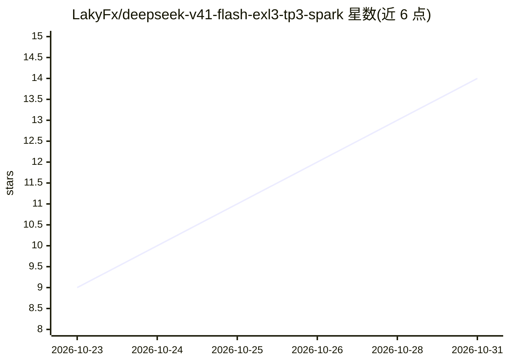

# LakyFx/deepseek-v41-flash-exl3-tp3-spark

⭐ 14 · Python · NOASSERTION · 推送 2026-10-28 · [GitHub](https://github.com/LakyFx/deepseek-v41-flash-exl3-tp3-spark) · 个人维护

**在3台DGX Spark上部署DeepSeek V4.1 Flash的推理配方与基准记录**

面向 NVIDIA DGX Spark 三机（TP3）部署 DeepSeek V4.1 Flash 1017 EXL3 量化模型（~3.51 bpw）的 TensorFold 推理配方仓库，当前生产配方为 1.2.7。核心机制包括：智能自适应 KV 保留（CPU 侧学习已验证的返回模式与重算成本，活体长上下文会话前缀复用最高 99.63%）、有界压力感知 KV 搬迁（每 rank 320 MiB 上限、8 MiB/s 回填）、自适应投机解码（学习验证成本与草稿接受率，R48 共享验证行）。发布 14 个配方及 SparkDash / 工作流 / RigMark 基准数据，含可复现的原生源码与清单；部分结论为建模估算而非实测端到端加速，README 多处标注了测量口径与限制。

## 筛选速览

| 维度 | 判定 | 备注 |
|---|---|---|
| AI 角色 | `ai-ecosystem` | LLM/agent 周边工具 |
| 许可风险 | `none` | NOASSERTION |
| 部署形态 | `None` |  |
| 模型依赖 | locked-api |  |
| 硬件要求 | — | 无带数字的原话,不猜 |
| 安装摩擦 | `medium` | 含编译或系统依赖之一 |
| 成熟度 | — | 结构信号不足 |

## 能力要点

- TensorFold TP3 三机配方：DeepSeek 1017 EXL3 ~3.51 bpw，7M KV / 3 GiB 检查点 / C12 / R48 预算
- 智能自适应 KV 保留：活体会话前缀复用最高 99.63%（长上下文子集），中位预fill约 0.66 s
- 自适应投机解码：从实际轮次学习验证成本与草稿接受率，共享预算内自适应分配
- 公开 14 个配方、168 单元 · 1,092 任务 · 4,846 请求的基准证据与可复现源码

## 适用场景

- 在多台 DGX Spark 上部署并调优 DeepSeek V4.1 Flash 的本地推理
- 为混合交互与自主 agent 工作负载提高前缀复用与 prefill 吞吐
- 查阅不同调度/KV 策略配方下的并发与吞吐基准数据

## 场景标签

`推理引擎` `模型评测` · 领域:评测与运维

## 证据(README 行号)

> L3: **Current production recipe: 1.2.7** — the exact deployed **X4** payload, now promoted under its final release numbe
> L5: **Smart adaptive KV retention + smart adaptive speculation.** More useful prefix reuse for mixed interactive work an
> L20: - **Build / install / launch 1.2.7** · profile · exact source

## 星数曲线

2026-10-23 9 → 2026-10-31 14（+5）

---
*卡片 v1 · prompt 1.4 · 生成 2026-10-31 · 置信度 high · 依据 README sha `d162a3d497ad` · [字段定义](../../DATASET.md)*
