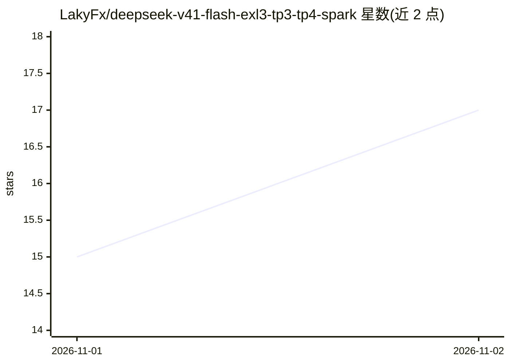

# LakyFx/deepseek-v41-flash-exl3-tp3-tp4-spark

⭐ 17 · Python · NOASSERTION · 推送 2026-10-31 · [GitHub](https://github.com/LakyFx/deepseek-v41-flash-exl3-tp3-tp4-spark) · 个人维护

**在 3-4 台 DGX Spark 上运行 DeepSeek 1017 EXL3 的推理配方与基准仓库**

TensorFold 项目的部署配方仓库：给出在 3 或 4 台 NVIDIA DGX Spark 上以张量并行（TP3/TP4）运行 DeepSeek 1017（EXL3 约 3.51 bpw 量化、switchless RoCE 互联）的精确构建、安装与启动步骤，并发布各版本（1.2.4–4.0.0）的冷预填、解码吞吐、KV 缓存命中与 agent 工作流基准测量及可复现证据。关键机制包括自适应投机解码、智能 KV 保留控制器与有界 KV 迁移规划。面向具备多节点 DGX Spark 硬件的本地 LLM 部署者，限制为硬件与配置特定。

## 筛选速览

| 维度 | 判定 | 备注 |
|---|---|---|
| AI 角色 | `ai-ecosystem` | LLM/agent 周边工具 |
| 许可风险 | `none` | NOASSERTION |
| 部署形态 | `None` |  |
| 模型依赖 | locked-api |  |
| 硬件要求 | — | 无带数字的原话,不猜 |
| 安装摩擦 | `medium` | 含编译或系统依赖之一 |
| 成熟度 | — | 结构信号不足 |

## 能力要点

- TP3/TP4 两套精确构建与启动配方，含 NCCL 补丁与四rank权重制备
- 智能自适应 KV 保留与自适应投机解码控制器（CPU 侧学习）
- 各版本冷预填/解码/工作流基准与可复现测量（如 TP4 4,289 tok/s 冷预填中位数）
- 7M–9M KV 配置、C12–C16 并发、401,408 上下文与 MAX/8K 视觉网关

## 适用场景

- 在多台 DGX Spark 上部署 DeepSeek 1017 本地推理服务
- 查询多节点 TP 部署的预填/解码吞吐实测数据与方法
- 参考 KV 缓存保留与投机解码的调参经验

## 场景标签

`推理引擎` · 领域:训练与推理

## 证据(README 行号)

> L1: # DeepSeek V4.1 Flash on 3 or 4 DGX Sparks
> L9: |Hardware|3 DGX Sparks|4 DGX Sparks, switchless cycle|
> L77: - **Build / install / launch 1.2.8** · profile · exact source

## 星数曲线

2026-11-01 15 → 2026-11-02 17（+2）

---
*卡片 v1 · prompt 1.4 · 生成 2026-10-31 · 置信度 high · 依据 README sha `17bc4fec9b14` · [字段定义](../../DATASET.md)*
