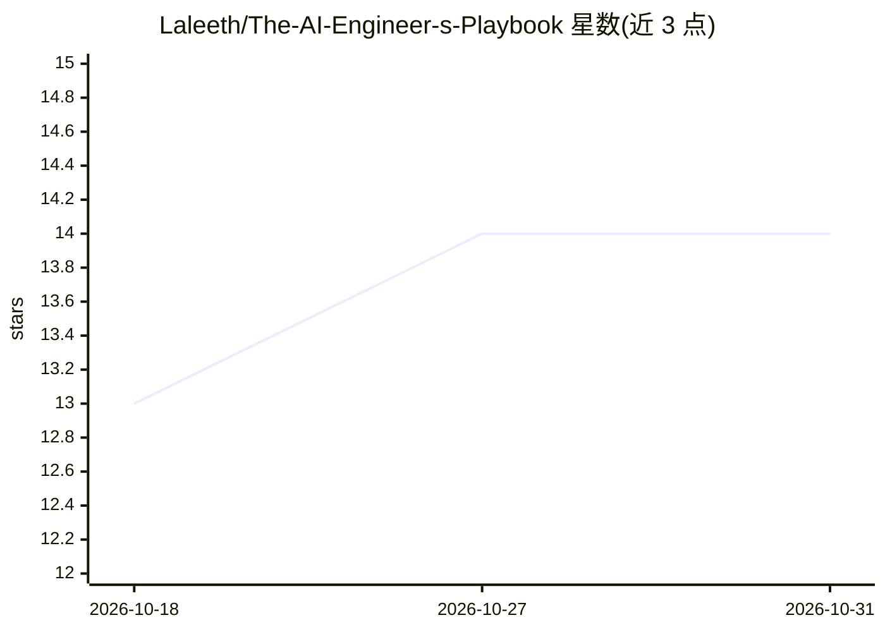

# Laleeth/The-AI-Engineer-s-Playbook

⭐ 14 · Python · MIT · 推送 2026-09-10 · [GitHub](https://github.com/Laleeth/The-AI-Engineer-s-Playbook) · 个人维护

**面向生产 AI 系统工程岗位的面试准备与实操参考手册**

由个人维护的工程知识库：13 个章节（00-12）、87 个文件约 25 万词，覆盖 LLM 内部机制、模型选型、RAG、Agent、评测、推理服务、生产运维、AI 安全、数据管道、系统设计与编码题。以 60 个会逐轮改变约束的场景题与编码题组织内容，每个场景附 trade-offs、指标、追问与面试官视角。特色机制是 CI 校验（scripts/verify.py）：代码块解析、数值声明重算、自述一致性检查，README 中的文件数/字数/章节计数均在每次推送时重新计算。内容全部完成、无待写章节，MIT 许可。

## 筛选速览

| 维度 | 判定 | 备注 |
|---|---|---|
| AI 角色 | `ai-knowledge` | 知识聚合/清单类 |
| 许可风险 | `permissive` | MIT |
| 部署形态 | `None` |  |
| 模型依赖 | — | README 未给出锁定关系 |
| 硬件要求 | — | 无带数字的原话,不猜 |
| 安装摩擦 | `low` | 无编译、无系统依赖或容器化 |
| 成熟度 | — | 结构信号不足 |

## 能力要点

- 13 章节 87 文件约 25 万词，60 个约束逐轮演进的场景与编码题
- CI 四项校验：代码可解析、数值声明重算、内部链接、README 自述一致性
- 场景题含 Trade-offs、Follow-ups、What Separates Senior From Staff 等结构
- 参考实现均为实际运行过的代码并记录修正过程

## 适用场景

- 准备 Senior/Staff AI Engineer、LLM Engineer 等岗位的系统设计与调试面试
- 在职工程师按问题索引快速查找 RAG 调试、容量规划、推理降本等方案
- 两人对练生产事故排查（一人扮仪表盘、一人提假设并索证）

## 场景标签

`教程课程` · 领域:学习与行业

## 证据(README 行号)

> L15: Preparation material for engineers interviewing for roles where the job is to **reason
> L149:  Total 87 250k
> L236: Most repositories in this space contain code nobody ran. This one runs it, in CI, on

## 星数曲线

2026-10-18 13 → 2026-10-31 14（+1）

---
*卡片 v1 · prompt 1.4 · 生成 2026-10-31 · 置信度 high · 依据 README sha `6d32efd13c56` · [字段定义](../../DATASET.md)*
