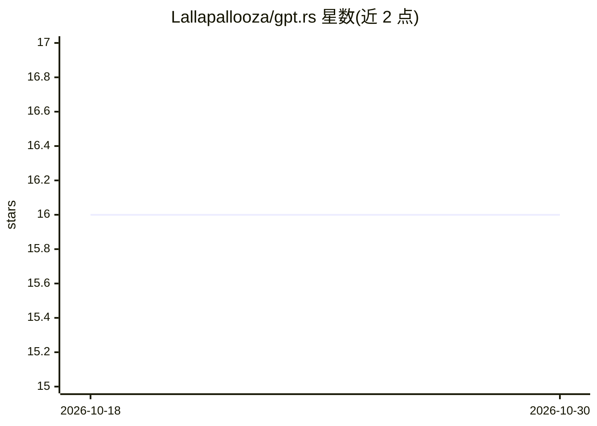

# Lallapallooza/gpt.rs

⭐ 16 · Rust · Apache-2.0 · 推送 2026-10-25 · [GitHub](https://github.com/Lallapallooza/gpt.rs) · 个人维护

**Rust 研究项目：便携张量 IR（PTIR）与多后端模型运行时**

以 Rust 编写的研究型 LLM playground，核心是便携张量程序表示 PTIR：层调用便携 functionals 记录为惰性图，由 faer、C、x86 等可插拔后端执行，权重以内存映射 checkpoint 视图加载，参数使用稳定 u128 id。已实现 GPT-2、ministral3、Qwen3.5 等因果 LM 与 ResNet/MobileNet 图像分类的前向推理，提供 CLI、Python 绑定与 Torch 逐层对拍测试。README 自述 API 与格式频繁变动，训练循环、GPU 后端等多为 roadmap 待办。

## 筛选速览

| 维度 | 判定 | 备注 |
|---|---|---|
| AI 角色 | `ai-ecosystem` | LLM/agent 周边工具 |
| 许可风险 | `permissive` | Apache-2.0 |
| 部署形态 | `library` | 以包/库形式分发 |
| 模型依赖 | — | README 未给出锁定关系 |
| 硬件要求 | — | 无带数字的原话,不猜 |
| 安装摩擦 | `medium` | 含编译或系统依赖之一 |
| 成熟度 | `idea` | |

## 能力要点

- PTIR 便携张量 IR，多层方言（tensor/tile/loop/isa）经 x86 后端下降到 C
- 可插拔后端：ref-cpu、faer、生成 C、多级 IR x86
- 权重以内存映射 checkpoint 视图加载，参数具备稳定 u128 id
- 内核级 Torch 对拍与端到端基线的正确性工具链

## 适用场景

- 在 Rust 中加载 GPT-2/Qwen3.5 做 LLM 前向推理与生成
- 研究张量 IR 与多后端编译执行机制
- 用 CLI/Python 绑定对模型做 dump、profile 与正确性验证

## 场景标签

`推理引擎` · 领域:训练与推理

## 证据(README 行号)

> L3: Rust-first **research project** for portable tensor programs (PTIR) and model runtimes.
> L42: - **Capability-based runtime**: `runtime::load_model` returns a dynamic model handle; the CLI runs `generate` / `fo
> L170: Forward inference for causal LMs (`gpt2`, `ministral3`, `qwen3_5_text`) and image classification

## 星数曲线

2026-10-18 16 → 2026-10-30 16（+0）

---
*卡片 v1 · prompt 1.4 · 生成 2026-10-30 · 置信度 mid · 依据 README sha `e4e8bc67addb` · [字段定义](../../DATASET.md)*
