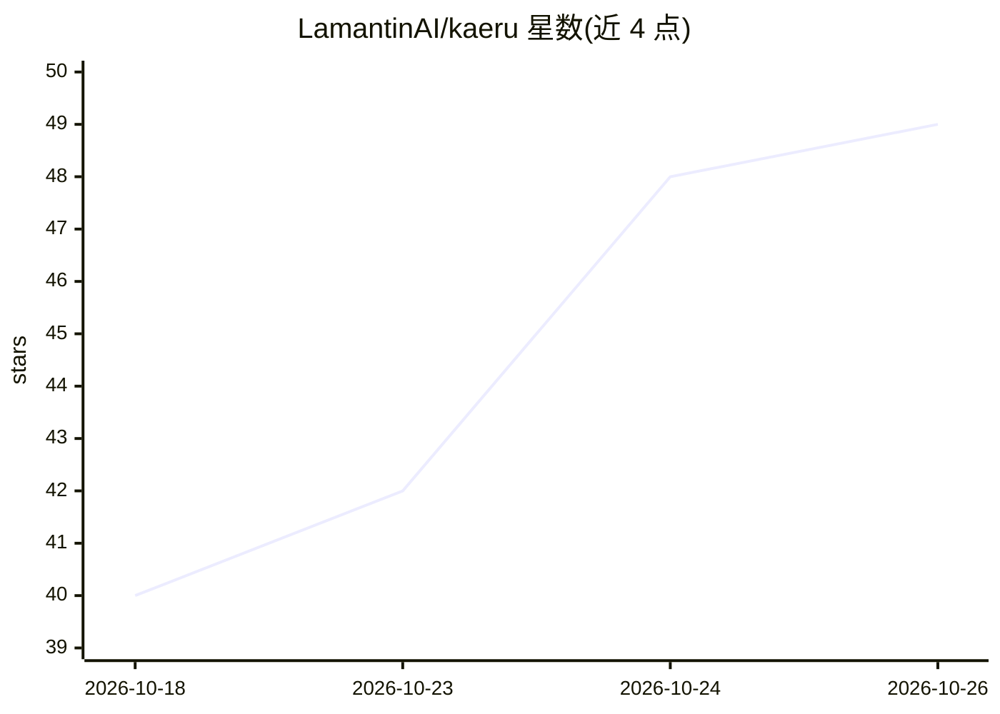

# LamantinAI/kaeru

⭐ 49 · Rust · NOASSERTION · 推送 2026-10-21 · [GitHub](https://github.com/LamantinAI/kaeru) · 组织维护

**面向 LLM agent 的跨 agent 认知记忆引擎，本地优先可云共享**

为 LLM agent 提供长期认知记忆的引擎：以 CozoDB 存储的类型化属性图为核心，分认知（工作层）与回忆（归档层）两tier，记录断言/撤回历史，支持按项目（initiative）作用域恢复上下文、溯源链与推理链。提供 35 个具名操作，通过 MCP、HTTP 与嵌入式 Rig 共享同一契约；本地优先，可选 kaeru-cloud 层让团队共享记忆。单二进制守护进程每 vault 一个，多 agent 会话并发接入。自述为 pre-1.0 alpha，升级前需备份。

## 筛选速览

| 维度 | 判定 | 备注 |
|---|---|---|
| AI 角色 | `ai-ecosystem` | LLM/agent 周边工具 |
| 许可风险 | `none` | NOASSERTION |
| 部署形态 | `library` | 以包/库形式分发 |
| 模型依赖 | — | README 未给出锁定关系 |
| 硬件要求 | — | 无带数字的原话,不猜 |
| 安装摩擦 | `medium` | 含编译或系统依赖之一 |
| 成熟度 | `idea` | |

## 能力要点

- CozoDB 两层图：认知/ hippocampus 工作层 + 回忆/ cortex 归档层
- 35 个具名记忆操作，MCP / HTTP / 嵌入式 Rig 共享契约
- 断言/撤回历史、溯源边（derived_from/supersedes）与推理链
- 可选 kaeru-cloud 团队共享层，本地优先默认

## 适用场景

- 让编码 agent 跨会话保留项目上下文与未完成事项
- 多 agent 团队共享一条记忆库并跟踪溯源
- 将沉淀的成果固化为长期知识并导出 Obsidian 友好的 Markdown

## 场景标签

`Agent 记忆` `知识图谱` · 领域:Agent 开发

## 证据(README 行号)

> L3: `kaeru` is a **cross-agent cognitive engine** for LLM agents — a typed graph that agents think in, plus a recollecti
> L28: `kaeru` is a **facilitator, not an enforcer**. The memory API exposes 35 named operations (`context`, `search`, `re
> L120: `kaeru-mcp` is a long-lived HTTP service: **one daemon per vault** owns the substrate, any number of agent session

## 星数曲线

2026-10-18 40 → 2026-10-26 49（+9）

---
*卡片 v1 · prompt 1.4 · 生成 2026-10-25 · 置信度 high · 依据 README sha `e6568de1c352` · [字段定义](../../DATASET.md)*
