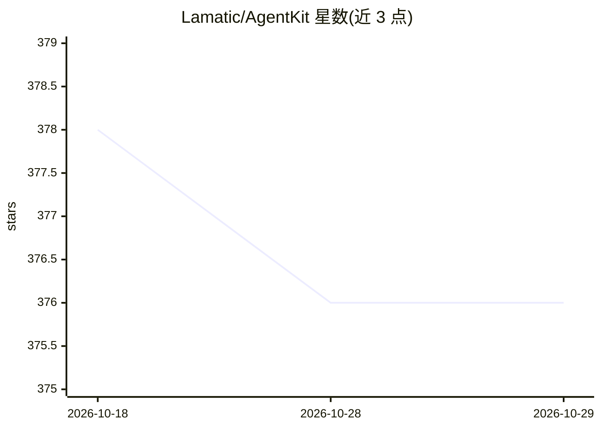

# Lamatic/AgentKit

⭐ 376 · TypeScript · MIT · 推送 2026-10-12 · [GitHub](https://github.com/Lamatic/AgentKit) · [官网](https://git.new/agentkit) · 组织维护

**Lamatic 平台的 AI Agent 应用模板库：70 个可部署 Kit**

Lamatic.ai 维护的 Agentic 应用模板集合：kits/ 目录下共 70 个条目，分为 kit（含 Next.js 可运行应用，22 个）、bundle（多流流水线，6 个）、template（单流，42 个），由 lamatic.config.ts 的 type 字段区分，README 目录由 registry.json 自动生成。条目覆盖客服分诊、简历筛选、RAG 问答、文档解析、语义搜索、博客生成等场景，各条目标注作者与 Live Demo 链接，依赖 Lamatic 平台的协作 Studio 与 Serverless 部署。

## 筛选速览

| 维度 | 判定 | 备注 |
|---|---|---|
| AI 角色 | `ai-ecosystem` | LLM/agent 周边工具 |
| 许可风险 | `permissive` | MIT |
| 部署形态 | `library` | 以包/库形式分发 |
| 模型依赖 | — | README 未给出锁定关系 |
| 硬件要求 | — | 无带数字的原话,不猜 |
| 安装摩擦 | `low` | 无编译、无系统依赖或容器化 |
| 成熟度 | — | 结构信号不足 |

## 能力要点

- 70 个条目分为 22 个 kit、6 个 bundle、42 个 template
- kit 类条目附带可运行的 Next.js 应用与 Live Demo
- 覆盖客服分诊、招聘筛选、RAG 问答、语义搜索等场景
- 目录由 registry.json 经脚本自动生成

## 适用场景

- 找现成模板快速部署客服、招聘、RAG 等 Agent 应用
- 在 Lamatic 平台上学习和复用多步 Agent 工作流
- 为网站嵌入文档问答或聊天组件

## 场景标签

`工作流自动化` `RAG` `文档问答` · 领域:效率与自动化

## 证据(README 行号)

> L9:  Stack to Build Reliable AI Agents
> L37: All contributions live in a flat `kits/` directory. Each entry is a **template** (single flow), **bundle** (multi-f

## 星数曲线

2026-10-18 378 → 2026-10-29 376（-2）

---
*卡片 v1 · prompt 1.4 · 生成 2026-10-21 · 置信度 mid · 依据 README sha `7d3edbf2f220` · [字段定义](../../DATASET.md)*
