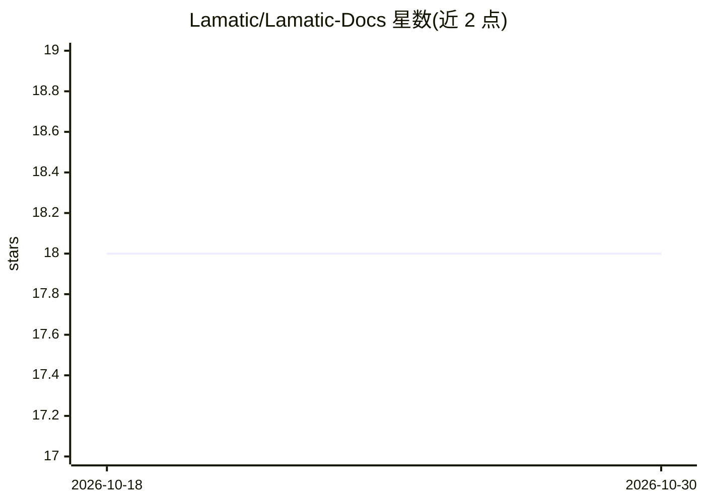

# Lamatic/Lamatic-Docs

⭐ 18 · MDX · MIT · 推送 2026-10-28 · [GitHub](https://github.com/Lamatic/Lamatic-Docs) · [官网](https://lamatic.ai/docs) · 组织维护

**Lamatic.ai 托管平台的产品文档仓库**

本仓库是 lamatic.ai 的文档源码。lamatic.ai 为云端托管的低代码平台，提供可视化流程编排器（Visual Flow builder）、向量数据库、面向应用/数据源/模型的集成能力，用于在边缘部署 GraphQL API，目标是让不同技术背景的用户构建、部署与管理智能体。文档本身可本地运行：需 Node.js 18+ 与 npm，通过 ppm/pnpm 安装依赖并在 localhost:3333 启动开发服务器。平台本体在云端注册使用，不在本仓库内。

## 筛选速览

| 维度 | 判定 | 备注 |
|---|---|---|
| AI 角色 | `ai-ecosystem` | LLM/agent 周边工具 |
| 许可风险 | `permissive` | MIT |
| 部署形态 | `library` | 以包/库形式分发 |
| 模型依赖 | — | README 未给出锁定关系 |
| 硬件要求 | — | 无带数字的原话,不猜 |
| 安装摩擦 | `low` | 无编译、无系统依赖或容器化 |
| 成熟度 | — | 结构信号不足 |

## 能力要点

- 文档化 lamatic.ai 托管平台：可视化流程构建器与向量数据库
- 支持应用、数据源与模型的集成，部署 GraphQL API 至边缘
- 本地运行文档需 Node.js 18+，pnpm dev 启动于 localhost:3333

## 适用场景

- 查阅 lamatic.ai 平台的指南与教程
- 为该文档仓库提交 issue 或 PR 参与贡献
- 本地搭建文档开发环境预览文档

## 场景标签

 · 领域:LLM 基础设施/低代码平台文档

## 证据(README 行号)

> L28: Managed platform with Visual Flow builder, VectorDB, Integrations to Apps, Data Sources and Models to deploy GraphQ
> L34: lamatic.ai is on a mission to democratize AI agent creation for everyone, regardless of their technical background.

## 星数曲线

2026-10-18 18 → 2026-10-30 18（+0）

---
*卡片 v1 · prompt 1.4 · 生成 2026-10-29 · 置信度 mid · 依据 README sha `c31e136ebb4d` · [字段定义](../../DATASET.md)*
