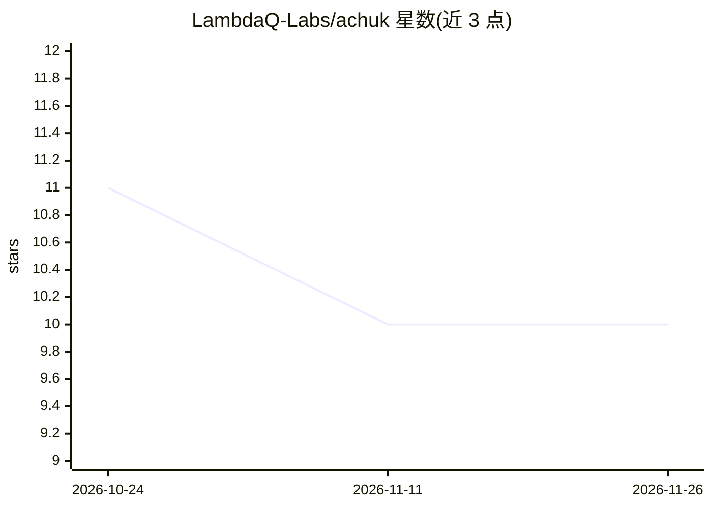

# LambdaQ-Labs/achuk

⭐ 10 · Zig · UPL-1.0 · 推送 2026-07-07 · [GitHub](https://github.com/LambdaQ-Labs/achuk) · [官网](https://achuk.dev) · 组织维护

**AI 优先编程语言：语法约束使 LLM 幻觉 API 不可生成**

Achuk 是一门 fork 自 Roc 的实验性编程语言，定位为由机器编写、编译器验证：编译器将真实符号表作为数据库暴露给模型，并在解码期施加语法约束，使模型只能引用存在的符号。内置自验证合成语料微调的捆绑模型与 llama.cpp 推理服务器（achuk ai gen），提供 MCP 服务器接入 Claude Code 等 agent，支持 emits-rust 转译与契约执行。自述状态为实验性、pre-alpha，Windows 二进制未在真实硬件测试。

## 筛选速览

| 维度 | 判定 | 备注 |
|---|---|---|
| AI 角色 | `ai-ecosystem` | LLM/agent 周边工具 |
| 许可风险 | `viral` | UPL-1.0 |
| 部署形态 | `library` | 以包/库形式分发 |
| 模型依赖 | local-ok | 支持本地模型 |
| 硬件要求 | — | 无带数字的原话,不猜 |
| 安装摩擦 | `low` | 无编译、无系统依赖或容器化 |
| 成熟度 | `idea` | |

## 能力要点

- 解码期语法约束使范围外 API 调用不可生成
- 安装包内置微调模型（achuk-0.5b-q8.gguf）与 llama.cpp 推理服务器
- 提供 MCP 服务器与 LSP，通过 achuk mcp install 注册到 Claude Code
- emit-rust 转译为可编译 Rust 以接入 crates.io

## 适用场景

- 让 agent 生成只能引用真实符号的 Achuk 代码
- 研究语法约束解码对幻觉 API 的影响
- 通过 MCP 将项目符号索引接入自己的 agent

## 场景标签

`代码生成` · 领域:编码与开发

## 证据(README 行号)

> L20: **Achuk fixes it at the language level.** The compiler exposes a live database of every real, in-scope symbol, and 
> L95: achuk mcp install         # registers the MCP server with Claude Code

## 星数曲线

2026-10-24 11 → 2026-11-26 10（-1）

---
*卡片 v1 · prompt 1.4 · 生成 2026-11-20 · 置信度 mid · 依据 README sha `218407f00aa5` · [字段定义](../../DATASET.md)*
