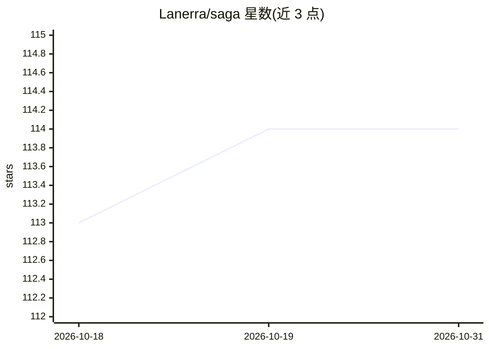

# Lanerra/saga

⭐ 114 · Python · Apache-2.0 · 推送 2026-09-15 · [GitHub](https://github.com/Lanerra/saga) · 个人维护

**本地优先的 agentic 小说写作 CLI：前提→大纲→分章草稿→导出**

面向单机单作者的 Python 命令行写作系统：将故事前提生成大纲、逐场景章节草稿与可导出的 Markdown 手稿。用 Neo4j 知识图谱追踪角色、事件与关系，用 LangGraph 对写作工作流做检查点以支持中断续写。不自带模型服务：用户需自行提供 OpenAI 兼容文本端点、支持 Ollama embeddings 协议的嵌入端点和 Neo4j（含 APOC、JDK）。已验证环境为 Linux x86-64、CPython 3.12.13、uv 管理锁定依赖。README 明确指出产出需要人工编辑，自动验收不代表编辑认可。

## 筛选速览

| 维度 | 判定 | 备注 |
|---|---|---|
| AI 角色 | `ai-native` | 本体是模型或模型工具 |
| 许可风险 | `permissive` | Apache-2.0 |
| 部署形态 | `self-host` | docker 或自建部署 |
| 模型依赖 | local-ok | 支持本地模型 |
| 硬件要求 | — | 无带数字的原话,不猜 |
| 安装摩擦 | `low` | 无编译、无系统依赖或容器化 |
| 成熟度 | — | 结构信号不足 |

## 能力要点

- 前提→大纲→分章草稿→Markdown 手稿导出的完整工作流
- Neo4j 知识图谱追踪角色/事件/关系
- LangGraph 检查点支持中断续写
- 本地优先：不自带模型服务与权重，端点由用户配置

## 适用场景

- 把一个故事前提扩展成结构化分章草稿
- 长篇写作中断后从检查点恢复继续生成
- 导出已验收章节为 Markdown 手稿

## 场景标签

`AI 写作` · 领域:内容生成

## 证据(README 行号)

> L3: SAGA (Semantic And Graph-enhanced Authoring) turns a story premise into an outline,
> L4: scene-by-scene drafts, and an exportable Markdown manuscript. It uses a Neo4j
> L8: SAGA is a local-first Python command-line application for one writer on one machine.

## 星数曲线

2026-10-18 113 → 2026-10-31 114（+1）

---
*卡片 v1 · prompt 1.4 · 生成 2026-10-23 · 置信度 mid · 依据 README sha `4b8a846efec8` · [字段定义](../../DATASET.md)*
