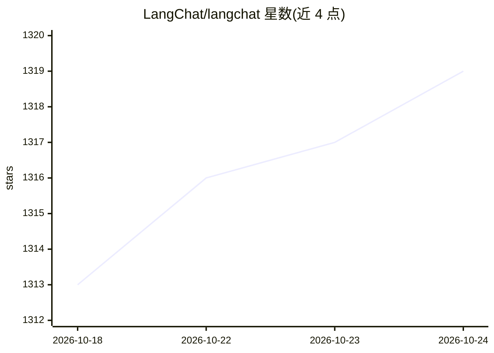

# LangChat/langchat

⭐ 1,319 · Vue · Apache-2.0 · 推送 2026-09-27 · [GitHub](https://github.com/LangChat/langchat) · [官网](https://langchat.cn) · 组织维护 · 中文 README

**Java/Vue 技术栈的开源 AI Agent 应用平台**

基于 Java 17、Spring Boot 3.3、LangChain4j 与 Vue 3 的模块化单体 AI Agent 应用平台：统一接入 OpenAI、Azure、Anthropic、Gemini、DeepSeek、Ollama 等多模型，提供 Agent 构建与调试界面、知识库 RAG（文档分段/向量化）、Skills、MCP 集成、智能问数（Text2SQL 数据分析）、图像生成/识别与应用市场，并带 RBAC 权限治理与 OpenAI 兼容 API。面向做技术验证、二次开发与团队内部场景建设的开发者。另设企业商业版 LangChat Agentic，开源版能力少于商业版。

## 筛选速览

| 维度 | 判定 | 备注 |
|---|---|---|
| AI 角色 | `ai-ecosystem` | LLM/agent 周边工具 |
| 许可风险 | `permissive` | Apache-2.0 |
| 部署形态 | `self-host` | docker 或自建部署 |
| 模型依赖 | local-ok | 支持本地模型 |
| 硬件要求 | — | 无带数字的原话,不猜 |
| 安装摩擦 | `low` | 无编译、无系统依赖或容器化 |
| 成熟度 | — | 结构信号不足 |

## 能力要点

- 多模型统一接入（OpenAI/Azure/Anthropic/Gemini/DeepSeek/Ollama 等）
- Agent 构建、调试、运行界面与 OpenAI 兼容 Chat Completions 接口
- 知识库 RAG：文档上传、分段、向量化与向量存储配置
- Skills、MCP 与智能问数（自然语言生成分析结果与图表）

## 适用场景

- 搭建团队内部的 AI Agent 与知识库问答平台
- 通过自然语言对结构化数据源做智能问数分析
- 以 OpenAI 兼容接口将 Agent 接入现有系统

## 场景标签

`Agent 框架` `RAG` `数据分析` · 领域:Agent 开发

## 证据(README 行号)

> L42: LangChat 是一个模块化、可扩展的开源 AI Agent 应用平台。它将模型接入、Agent 构建、知识库 RAG、Skills、MCP、数据分析和权限管理整合到同一套 Java 与 Vue 技术体系中，帮助开发者快速搭建可
> L50: |多模型接入|统一管理 OpenAI、Azure OpenAI、Anthropic、Gemini、DeepSeek、通义千问、智谱、Ollama 及 OpenAI 兼容服务|

## 星数曲线

2026-10-18 1,313 → 2026-10-24 1,319（+6）

---
*卡片 v1 · prompt 1.4 · 生成 2026-10-21 · 置信度 mid · 依据 README sha `900200abc231` · [字段定义](../../DATASET.md)*
