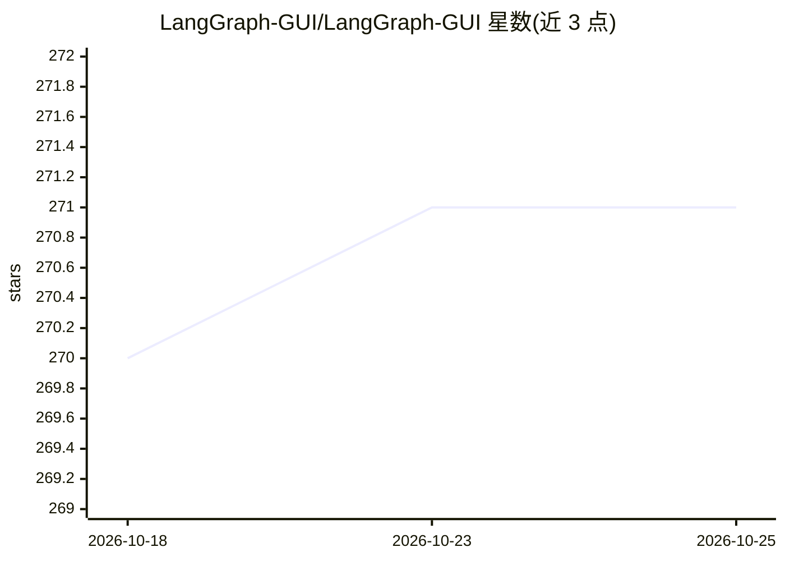

# LangGraph-GUI/LangGraph-GUI

⭐ 271 · TypeScript · MIT · 推送 2026-01-24 · [GitHub](https://github.com/LangGraph-GUI/LangGraph-GUI) · [官网](https://langgraph-gui.github.io/) · 组织维护

**LangGraph 可视化节点图编辑器，可接本地或在线 LLM 运行**

基于 SvelteFlow 前端与 FastAPI 后端的 LangGraph 图形界面：以节点-边编辑方式构建工作流，并可通过 Ollama 等本地模型或在线 API 运行。部署以 Docker Compose 为主（含拉取 Ollama 模型的步骤），另提供 Kubernetes 配置与 Electron（需 npm）路径；Linux 下要求 Docker Compose 环境，可选 nv-docker 支持 GPU 运行 Ollama。访问 localhost:3000 使用。

## 筛选速览

| 维度 | 判定 | 备注 |
|---|---|---|
| AI 角色 | `ai-ecosystem` | LLM/agent 周边工具 |
| 许可风险 | `permissive` | MIT |
| 部署形态 | `self-host` | docker 或自建部署 |
| 模型依赖 | local-ok | 支持本地模型 |
| 硬件要求 | — | 无带数字的原话,不猜 |
| 安装摩擦 | `low` | 无编译、无系统依赖或容器化 |
| 成熟度 | — | 结构信号不足 |

## 能力要点

- SvelteFlow 前端 + FastAPI 后端的节点-边可视化工作流编辑
- 支持 Ollama 本地模型与在线 API 运行 LLM
- Docker Compose 一键部署，附 Kubernetes 配置

## 适用场景

- 用可视化界面编排 LangGraph 工作流而不写代码
- 自托管运行接本地 Ollama 模型的 LLM 应用
- 在 K8s 集群中部署工作流编辑环境

## 场景标签

`Agent 框架` · 领域:Agent 开发

## 证据(README 行号)

> L3: LangGraph-GUI is an user-friendly graphical interface for interacting with SvelteFlow frontend and fastAPI backend u
> L30: Prepare: Build the Docker containers and pull ollama models :

## 星数曲线

2026-10-18 270 → 2026-10-25 271（+1）

---
*卡片 v1 · prompt 1.4 · 生成 2026-10-22 · 置信度 high · 依据 README sha `89f07647e768` · [字段定义](../../DATASET.md)*
