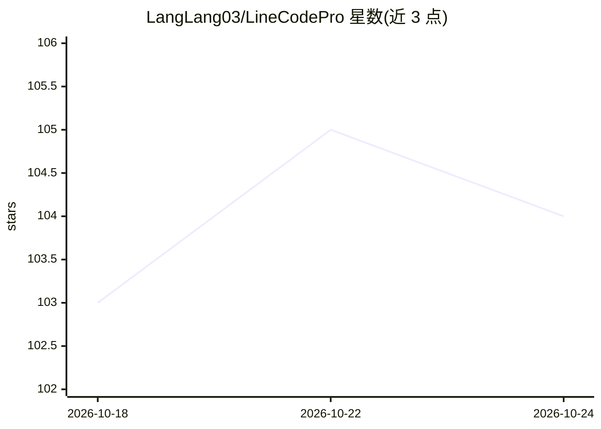

# LangLang03/LineCodePro

⭐ 104 · C++ · AGPL-3.0 · 推送 2026-10-19 · [GitHub](https://github.com/LangLang03/LineCodePro) · 个人维护 · 中文 README

**Android 上的原生 AI 编程工作台（C++23/HuxerUI）**

用现代 C++23 与 HuxerUI 构建的原生跨平台 AI 编程工作区，面向 Android（6.0+，主平台；Windows 开发中）。统一 OpenAI 兼容 Chat Completions、OpenAI/Codex Responses、Anthropic Messages 与本地 GGUF 模型到一个流式对话界面；模型可通过工具循环读取/编辑项目文件、执行 shell 命令、搜索网页、处理图片，并可委派任务给多 Agent 流水线。支持本地存储、SSH、Termux 工作区，可接入 HTTP MCP 服务器与 SKILL.md 技能包。数据以 SQLite 本地存储；Android 发布包在 GitHub Releases 提供，源码构建需 HuxerUI SDK 0.3.0、JDK 17、NDK 等工具链。项目声明处于积极开发中，提示在重要环境使用前审查 AI 生成的代码。

## 筛选速览

| 维度 | 判定 | 备注 |
|---|---|---|
| AI 角色 | `ai-native` | 本体是模型或模型工具 |
| 许可风险 | `dual` | AGPL-3.0 |
| 部署形态 | `desktop` | 安装包/桌面程序 |
| 模型依赖 | — | README 未给出锁定关系 |
| 硬件要求 | — | 无带数字的原话,不猜 |
| 安装摩擦 | `high` | 编译与系统依赖俱全 |
| 成熟度 | `idea` | |

## 能力要点

- OpenAI 兼容/Responses/Anthropic/本地 GGUF 模型共享一个流式界面
- 完整工具循环：文件读写编辑、shell 执行、网页搜索、图片理解生成
- 多 Agent 委派与流水线，执行时间线全程可审查
- 支持 HTTP MCP 服务器、自定义 Agent 与 SKILL.md 技能包（SkillHub）

## 适用场景

- 在 Android 设备上进行 AI 辅助的编程与项目文件编辑
- 通过 SSH 或 Termux 远程操作工作区执行命令
- 长会话任务管理：上下文追踪、自动压缩、持久记忆与可恢复历史

## 场景标签

`编码 Agent` `多智能体` · 领域:Agent 开发

## 证据(README 行号)

> L14: **LineCode Pro is a native, cross-platform AI coding workspace built with modern C++23 and HuxerUI.** It combines s
> L28: - **Model-independent conversations** — OpenAI-compatible Chat Completions, OpenAI/Codex Responses, Anthropic Messa

## 星数曲线

2026-10-18 103 → 2026-10-24 104（+1）

---
*卡片 v1 · prompt 1.4 · 生成 2026-10-23 · 置信度 high · 依据 README sha `14c9382a926a` · [字段定义](../../DATASET.md)*
