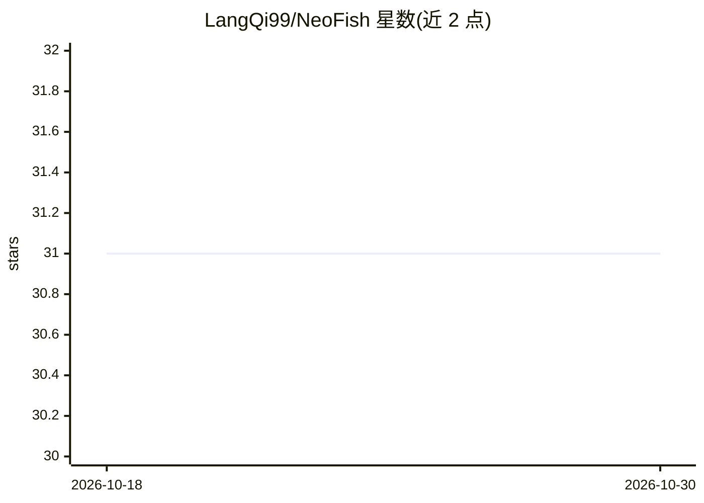

# LangQi99/NeoFish

⭐ 31 · Python · GPL-3.0 · 推送 2026-08-04 · [GitHub](https://github.com/LangQi99/NeoFish) · 个人维护 · 中文 README

**对话式 AI Agent：用自然语言操控浏览器完成网页任务**

面向普通用户的全能 AI Agent 原型系统：通过自然语言下达指令，基于 Playwright 引擎操控浏览器，执行页面导航、点击、输入、滚动、截图与信息提取。支持 Web、Telegram、QQ 三端接入，采用 FastAPI + WebSocket 前后端分离架构，同一套 Agent 核心可复用。遇到验证码或扫码登录时自动暂停等待人工介入。通过 .env 配置接入任何支持工具调用的大模型 API（默认兼容 Anthropic/OpenAI 接口规范），也提供无前端的纯 HTTP API 模式供其他应用集成。

## 筛选速览

| 维度 | 判定 | 备注 |
|---|---|---|
| AI 角色 | `ai-native` | 本体是模型或模型工具 |
| 许可风险 | `viral` | GPL-3.0 |
| 部署形态 | `library` | 以包/库形式分发 |
| 模型依赖 | locked-api |  |
| 硬件要求 | — | 无带数字的原话,不猜 |
| 安装摩擦 | `low` | 无编译、无系统依赖或容器化 |
| 成熟度 | `idea` | |

## 能力要点

- 深度集成 Playwright 引擎，支持导航、点击、输入、滚动与截图分析
- Web / Telegram / QQ 三端接入，同一 Agent 核心复用
- 遇验证码/扫码登录自动暂停，人工确认后继续
- 提供 headless 纯 HTTP API 模式（POST /v1/chat，支持会话与浏览器上下文复用）

## 适用场景

- 让 Agent 代为搜索网页并总结文章标题与链接
- 自动填写调查问卷等重复性网页操作
- 通过 Telegram 或 QQ 对话远程指挥浏览器任务
- 作为后端能力嵌入 Bot、脚本或内部系统

## 场景标签

`浏览器自动化` · 领域:效率与自动化

## 证据(README 行号)

> L16: **NeoFish** 是一款旨在让人人都能轻松使用的全能 AI Agent 原型系统。它不仅是一个可以聊天的助手，更是一个能够真正**操控浏览器、接管繁琐工作**的数字劳动力。无需复杂的编程知识，只要用自然语言下达指令，NeoF
> L24: - 🤖 **全能浏览器交互**: 深度集成 `Playwright` 引擎，支持页面导航、元素点击、键盘输入、滚动和截图分析。

## 星数曲线

2026-10-18 31 → 2026-10-30 31（+0）

---
*卡片 v1 · prompt 1.4 · 生成 2026-10-26 · 置信度 mid · 依据 README sha `2fbaddd4063a` · [字段定义](../../DATASET.md)*
