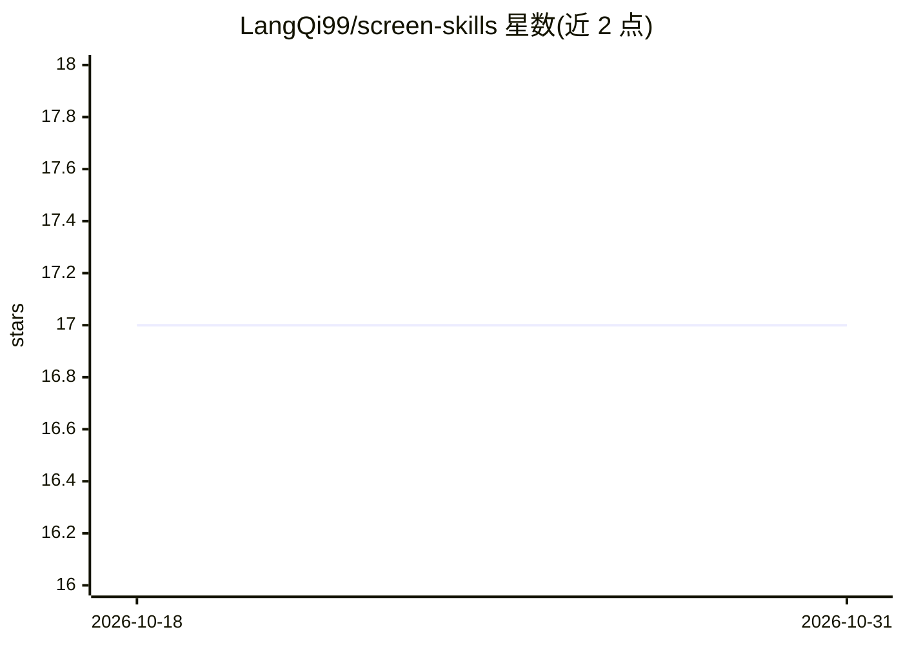

# LangQi99/screen-skills

⭐ 17 · Python · 推送 2026-01-26 · [GitHub](https://github.com/LangQi99/screen-skills) · 个人维护 · 中文 README

**供 LLM 调用的跨平台截图技能库，AI 助手可自动截图嵌入文档**

面向 LLM/AI 助手的技能库，提供 macOS、Windows、Linux 三平台的屏幕截图与窗口识别能力：全屏截图、按窗口精准截图、列出窗口（支持中英文应用名模糊匹配）、JSON 格式输出窗口信息。典型工作流是由 AI 通过提示词自动运行代码、截取终端输出并嵌入 Markdown，适用于论文、技术文档、产品演示等场景。macOS 端使用 Swift Accessibility API 与原生 screencapture 命令，Python 脚本调用。README 声明项目正在开发中，欢迎 star 和 fork。

## 筛选速览

| 维度 | 判定 | 备注 |
|---|---|---|
| AI 角色 | `ai-ecosystem` | LLM/agent 周边工具 |
| 许可风险 | `none` | — |
| 部署形态 | `library` | 以包/库形式分发 |
| 模型依赖 | — | README 未给出锁定关系 |
| 硬件要求 | — | 无带数字的原话,不猜 |
| 安装摩擦 | `low` | 无编译、无系统依赖或容器化 |
| 成熟度 | `idea` | |

## 能力要点

- 全屏与特定窗口截图，支持中英文应用名模糊匹配
- 跨 macOS/Windows/Linux 三平台脚本
- macOS 端基于 Swift Accessibility API 与原生 screencapture，零外部依赖
- AI 可自动完成运行代码、截取输出、嵌入 Markdown 的完整流程

## 适用场景

- 写课程论文或实验报告时让 AI 自动附上代码运行截图
- 生成带实际运行截图的技术文档和教程
- 自动生成测试结果与产品演示文档

## 场景标签

`AI 写作` · 领域:内容生成

## 证据(README 行号)

> L23: **Screen Skills** 是一个专为 LLM（大语言模型）设计的技能库，使 AI 助手能够智能地捕获 macOS 屏幕截图。这个项目特别适合需要在文档、论文或演示中嵌入实时截图的场景。正在开发中，欢迎 star 和 fo
> L27: - 🤖 **自动运行代码**并截取终端输出

## 星数曲线

2026-10-18 17 → 2026-10-31 17（+0）

---
*卡片 v1 · prompt 1.4 · 生成 2026-10-30 · 置信度 mid · 依据 README sha `7082476de301` · [字段定义](../../DATASET.md)*
