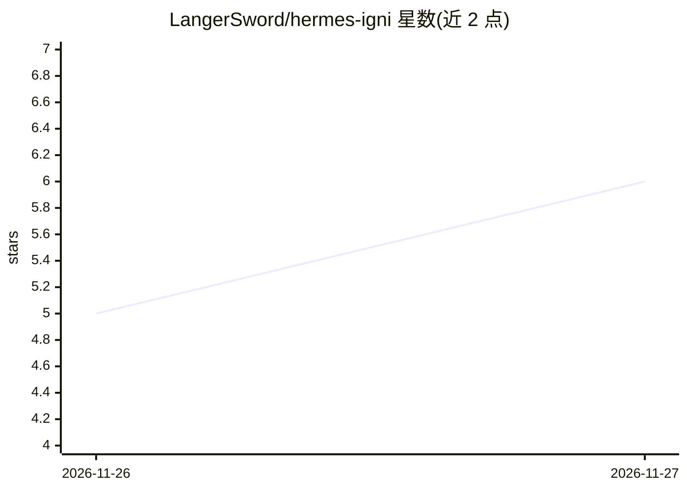

# LangerSword/hermes-igni

⭐ 6 · Python · MIT · 推送 2026-11-24 · [GitHub](https://github.com/LangerSword/hermes-igni) · 个人维护

**Hermes Agent 的巫师风卡牌游戏插件：昆特牌与法力对决**

为 Hermes Agent 平台编写的非官方插件，内置两副规则完整的卡牌游戏：Gwent（三行战场、天气、间谍、号角、灼烧、三局两胜）与 Arena（30 点生命、法力、嘲讽、冲锋、圣盾、战吼）。对手为本地规则引擎，只读取自己的手牌与公共场面；agent 仅充当裁判中转玩家操作。引擎纯 Python 标准库实现，无网络、无模型调用、无 API key，可通过聊天、TUI 面板或桌面卡桌游玩，附 29 项单元测试与自对弈冒烟脚本。

## 筛选速览

| 维度 | 判定 | 备注 |
|---|---|---|
| AI 角色 | `ai-enhanced` | 去掉 AI 部分产品仍成立 |
| 许可风险 | `permissive` | MIT |
| 部署形态 | `None` |  |
| 模型依赖 | — | README 未给出锁定关系 |
| 硬件要求 | — | 无带数字的原话,不猜 |
| 安装摩擦 | `low` | 无编译、无系统依赖或容器化 |
| 成熟度 | — | 结构信号不足 |

## 能力要点

- Gwent 与 Arena 两副完整规则引擎，种子确定、可复现发牌
- 对手手牌隔离边界：工具结果与快照只含数量不含手牌
- 纯 Python 标准库，无第三方运行时依赖、无网络
- 聊天、TUI 计分板、桌面像素卡桌三种游玩界面

## 适用场景

- 在 Hermes 会话中用自然语言指令与 AI 对弈昆特牌
- 在桌面端打开像素风卡桌进行可视化对局
- 运行自对弈演示或测试脚本验证规则引擎行为

## 场景标签

 · 领域:游戏/桌面工具

## 证据(README 行号)

> L3: **A Witcher-inspired card game plugin for Hermes Agent.** Igni runs two real,
> L24: The opponent is a local rule-based AI. It sees its own hand and the public
> L28: No API keys. No network. No model calls. The engine is Python standard library;

## 星数曲线

2026-11-26 5 → 2026-11-27 6（+1）

---
*卡片 v1 · prompt 1.4 · 生成 2026-11-26 · 置信度 high · 依据 README sha `ea0da2b95bf4` · [字段定义](../../DATASET.md)*
