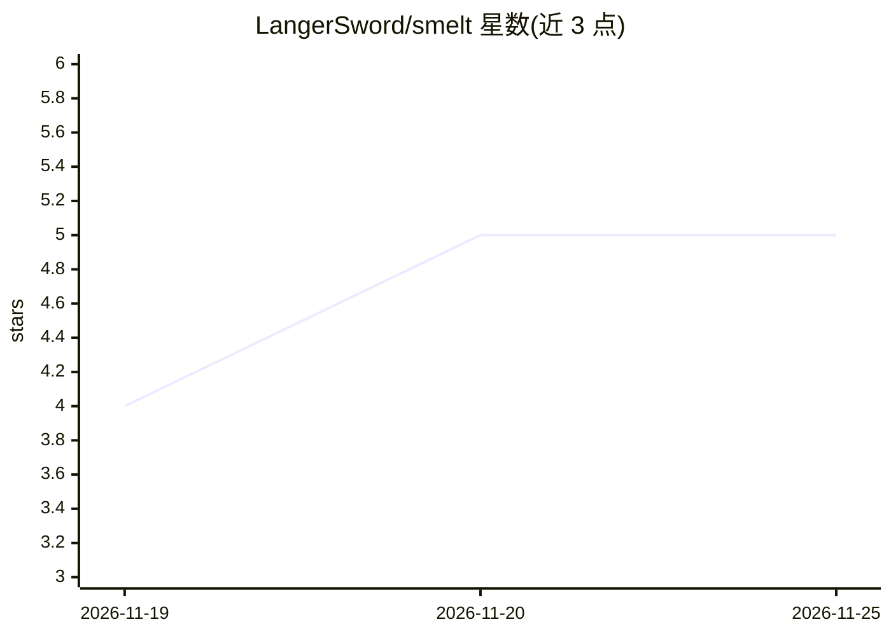

# LangerSword/smelt

⭐ 5 · Python · MIT · 推送 2026-11-19 · [GitHub](https://github.com/LangerSword/smelt) · 个人维护

**把慢的纯 Python 函数熔炼为已验证 Rust 扩展的开发工具**

smelt 针对一个纯 Python 函数先冻结 200+ 条输入/输出案例作为差分 oracle，再由任意模型/提供商生成等价的 pyo3 Rust 扩展；代码而非模型负责校验每条案例答案一致，通过后计时并给出带置信区间的加速比，失败的改写被拒绝并可将编译错误/不一致案例作为修复证据回喂。Python 原函数保留为回退。仅接受 str/int/float/bool/list/tuple 等有限参数类型，i64 域外整数为捕获期拒绝。

## 筛选速览

| 维度 | 判定 | 备注 |
|---|---|---|
| AI 角色 | `ai-ecosystem` | LLM/agent 周边工具 |
| 许可风险 | `permissive` | MIT |
| 部署形态 | `library` | 以包/库形式分发 |
| 模型依赖 | locked-api |  |
| 硬件要求 | — | 无带数字的原话,不猜 |
| 安装摩擦 | `low` | 无编译、无系统依赖或容器化 |
| 成熟度 | `idea` | |

## 能力要点

- oracle 优先：200+ 录制案例哈希只读，校验在代码不在模型
- 模型无关：v0.8 起支持 nvidia/gemini/local(llama.cpp)/openai/openrouter 等提供商
- 提供 MCP server、Hermes 插件、Claude Code 插件与 Agent Skill 三种接入面
- 安全机制：静态扫描拒绝 unsafe/额外 crate/build.rs，构建在临时目录与资源限制下运行

## 适用场景

- 为热点纯 Python 函数生成并验证 Rust 加速版本
- 把 smelt 循环接入 Claude Code/Cursor 等编码 agent
- 在 CI 中按 PR 标签触发候选函数扫描与结果评论

## 场景标签

`代码生成` · 领域:编码与开发

## 证据(README 行号)

> L3: **Smelt a slow, pure Python function into a verified Rust extension. Only proven metal ships.**
> L8: — writes an equivalent Rust extension (`pyo3`). **Code, not the model, checks
> L44: |`smelt mcp`|serve smelt as an MCP server (stdio) for any coding agent|

## 星数曲线

2026-11-19 4 → 2026-11-25 5（+1）

---
*卡片 v1 · prompt 1.4 · 生成 2026-11-21 · 置信度 mid · 依据 README sha `9255ab13d27f` · [字段定义](../../DATASET.md)*
