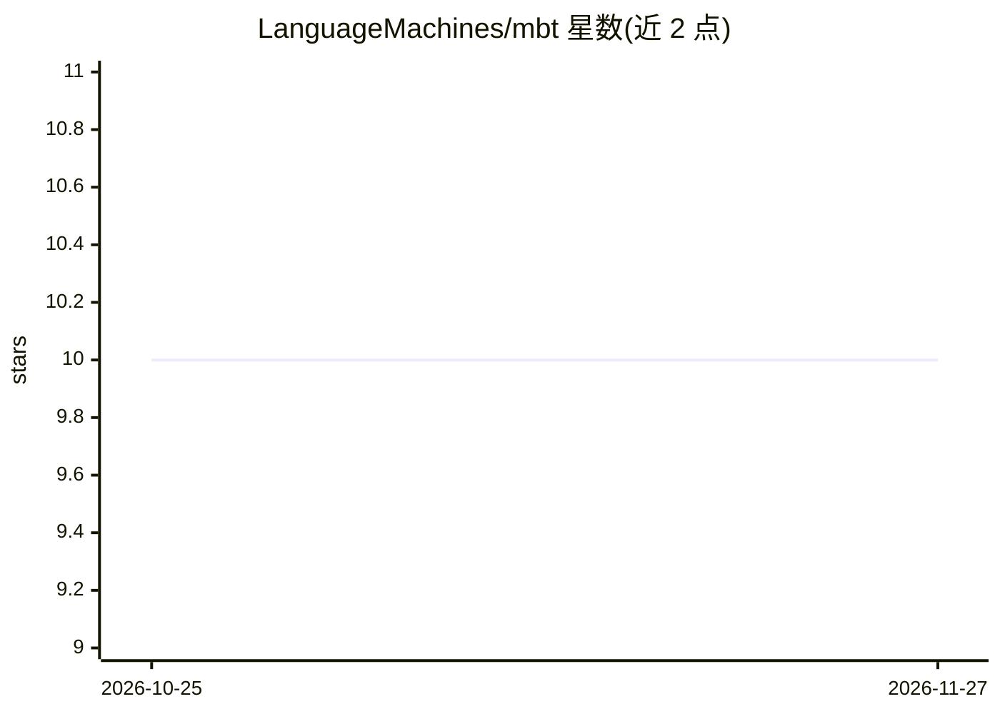

# LanguageMachines/mbt

⭐ 10 · C++ · GPL-3.0 · 推送 2026-11-13 · [GitHub](https://github.com/LanguageMachines/mbt) · [官网](https://languagemachines.github.io/mbt) · 组织维护

**NLP 研究者用的基于记忆的词性标注器生成工具**

MBT 是一个基于记忆的标注器生成器与标注器，由 Radboud University、Tilburg University 与 University of Antwerp 的语言研究组维护，采用 GPL v3 许可发布。用户以训练数据生成标注器后对新文本进行标注，底层依赖 timbl 与 ticcutils，构建基于 GNU Autotools，分发内含示例数据与文档。README 列出在 Linux 多发行版与 Mac OS X 10.10 上经测试，需 GCC 或 Clang 编译安装，另提供 Dockerfile 构建途径。

## 筛选速览

| 维度 | 判定 | 备注 |
|---|---|---|
| AI 角色 | `ai-native` | 本体是模型或模型工具 |
| 许可风险 | `viral` | GPL-3.0 |
| 部署形态 | `self-host` | docker 或自建部署 |
| 模型依赖 | — | README 未给出锁定关系 |
| 硬件要求 | — | 无带数字的原话,不猜 |
| 安装摩擦 | `low` | 无编译、无系统依赖或容器化 |
| 成熟度 | — | 结构信号不足 |

## 能力要点

- 基于记忆的标注器生成与标注一体（依赖 timbl）
- 提供示例数据文件（demos/）与文档（docs/）
- 支持源码编译安装与 Dockerfile 容器构建

## 适用场景

- 为自然语言文本训练并运行序列标注模型
- 在 NLP 研究中复现基于记忆学习的标注实验

## 场景标签

 · 领域:自然语言处理

## 证据(README 行号)

> L5: Mbt: Tilburg Memory Based Tagger
> L41: - timbl

## 星数曲线

2026-10-25 10 → 2026-11-27 10（+0）

---
*卡片 v1 · prompt 1.4 · 生成 2026-11-20 · 置信度 high · 依据 README sha `2989ce46fb97` · [字段定义](../../DATASET.md)*
