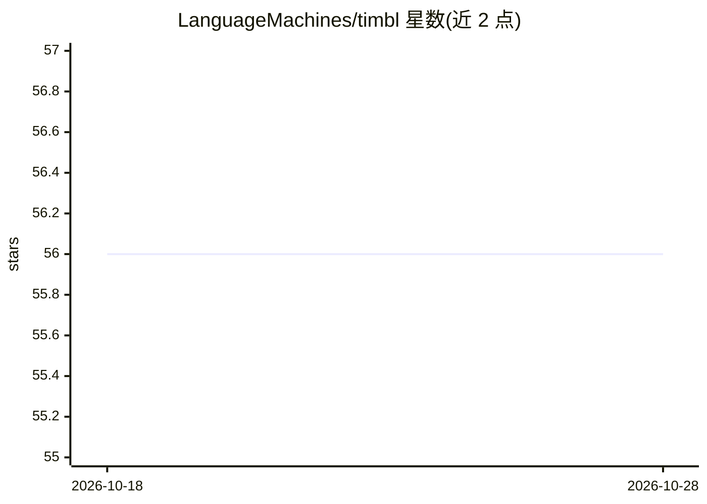

# LanguageMachines/timbl

⭐ 56 · C++ · GPL-3.0 · 推送 2026-08-17 · [GitHub](https://github.com/LanguageMachines/timbl) · [官网](https://languagemachines.github.io/timbl) · 组织维护

**记忆学习算法软件包：提供 kNN 与决策树分类器**

TiMBL 是实现多种基于记忆的学习算法的开源 C++ 软件包，核心算法包括 IB1-IG（带特征加权的 k 近邻分类，适用于符号特征空间）与 IGTree（IB1-IG 的决策树近似实现）。算法在内存中显式存储训练集表示，测试时由最相似样本外推分类。主要作为自然语言处理中的机器学习分类组件使用，也可用于其他监督学习场景。由拉德堡德大学、蒂尔堡大学及安特卫普大学研究组维护，GPLv3 许可。

## 筛选速览

| 维度 | 判定 | 备注 |
|---|---|---|
| AI 角色 | `ai-native` | 本体是模型或模型工具 |
| 许可风险 | `viral` | GPL-3.0 |
| 部署形态 | `self-host` | docker 或自建部署 |
| 模型依赖 | — | README 未给出锁定关系 |
| 硬件要求 | — | 无带数字的原话,不猜 |
| 安装摩擦 | `low` | 无编译、无系统依赖或容器化 |
| 成熟度 | — | 结构信号不足 |

## 能力要点

- 实现 IB1-IG（带特征加权的 k 近邻分类）与 IGTree 决策树算法
- 适用于符号特征空间的监督分类
- 支持 Linux（x86/ARM）与 macOS（Intel/ARM64）

## 适用场景

- 自然语言处理任务中作为机器学习分类组件
- 符号特征数据的监督分类与预测

## 场景标签

 · 领域:机器学习/NLP

## 证据(README 行号)

> L16: TiMBL is an open source software package implementing several memory-based
> L17: learning algorithms, among which IB1-IG, an implementation of k-nearest
> L24: For over twenty-five years TiMBL has been mostly used in natural language

## 星数曲线

2026-10-18 56 → 2026-10-28 56（+0）

---
*卡片 v1 · prompt 1.4 · 生成 2026-10-24 · 置信度 high · 依据 README sha `7b30e5ce57f3` · [字段定义](../../DATASET.md)*
