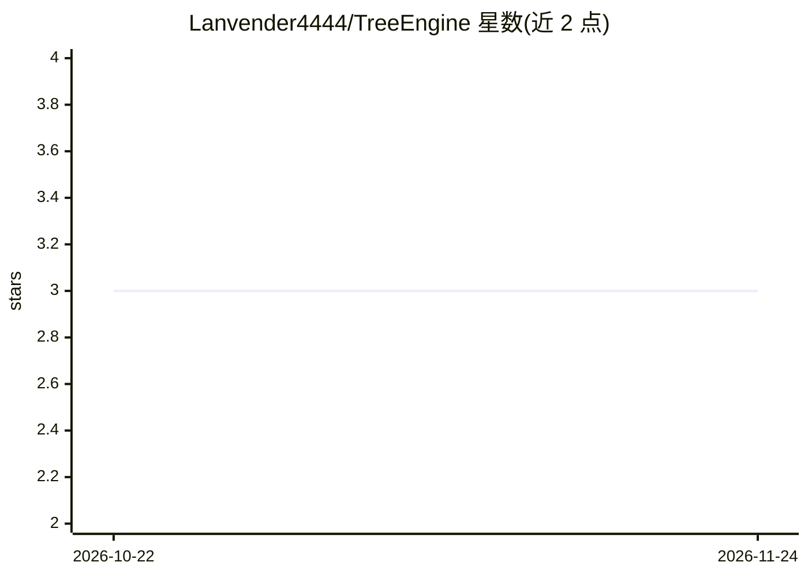

# Lanvender4444/TreeEngine

⭐ — · [GitHub]() · 个人维护 · 中文 README

**RAG 与 AI Agent 的细粒度证据检索与上下文重建库**

Python 检索库，将文档解析为结构树，先检索细粒度 Block 作为可引用证据，再在查询时重建连贯的 ContextSpan 供 LLM 阅读。核心路径仅需 Python≥3.11 与自带 SQLite，无需 LLM 或向量库；词法/语义/混合检索可选，向量索引为可选 extra。支持布局感知 PDF 解析（多栏阅读顺序、标题检测）、MCP server 供 agent 增量导航文档、以及 LangChain/LlamaIndex 检索器适配。当前为 Alpha（0.3.0.dev），默认后端为单 SQLite 文件，面向单进程低并发场景。

## 筛选速览

| 维度 | 判定 | 备注 |
|---|---|---|
| AI 角色 | `ai-ecosystem` | LLM/agent 周边工具 |
| 许可风险 | `permissive` | — |
| 部署形态 | `library` | 以包/库形式分发 |
| 模型依赖 | — | README 未给出锁定关系 |
| 硬件要求 | — | 无带数字的原话,不猜 |
| 安装摩擦 | `low` | 无编译、无系统依赖或容器化 |
| 成熟度 | `idea` | |

## 能力要点

- 检索与阅读单元分离：Block 定位证据，ContextSpan 供模型阅读
- 默认路径无 LLM、无向量库，仅用 SQLite + FTS5 即可运行
- MCP server 提供 search/retrieve/build_context 等工具供 agent 调用
- 布局感知 PDF 结构恢复（多栏阅读顺序、标题、书签混合大纲）

## 适用场景

- 为现有 RAG 流水线重建细粒度证据的阅读上下文
- 让 agent 通过 MCP 增量浏览和检索本地文档
- 本地化文档问答，不依赖外部向量数据库或 LLM 服务

## 场景标签

`RAG` `文档解析` `文档问答` · 领域:知识与检索

## 证据(README 行号)

> L21: It retrieves small, citable pieces of evidence first, then reconstructs coherent reading context around that eviden
> L86: |`[mcp]`|`treeengine-mcp`, an MCP server for agents|
> L294: No LLM is required for the core storage and retrieval model.

## 星数曲线

2026-10-22 3 → 2026-11-24 3（+0）

---
*卡片 v1 · prompt 1.4 · 生成 2026-11-22 · 置信度 high · 依据 README sha `65340e97a095` · [字段定义](../../DATASET.md)*
