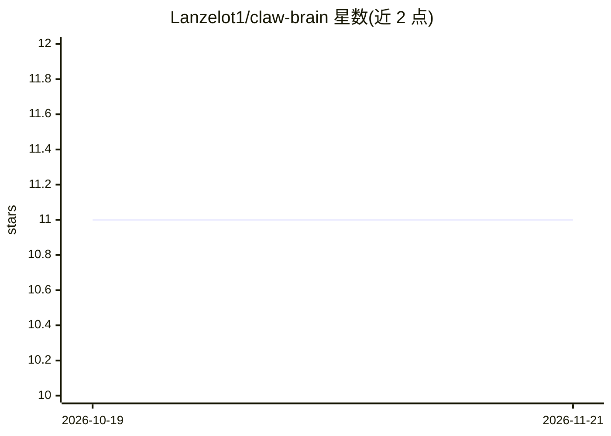

# Lanzelot1/claw-brain

⭐ 11 · Shell · MIT · 推送 2026-04-18 · [GitHub](https://github.com/Lanzelot1/claw-brain) · [官网](https://www.kayba.ai) · 组织维护

**基于 Claude Code 的个人与 agent 知识库模板**

一个 fork 即用的知识管理系统模板（second brain），由 Claude Code 的 slash 命令驱动：/onboard 建立个人档案、/process-inbox 自动归类收件箱文件、/synthesize 编译跨来源 wiki 页、/sleep 自主研究循环、/recall 检索知识。知识以 markdown 和 JSON 文件存储，无数据库，通过 co-located JSON schema、pre-commit hook 与 CI 做结构化与来源校验；支持个人、团队共享、nanoclaw 群组大脑以及 openclaw bot 通过 git 工作流协作写入。

## 筛选速览

| 维度 | 判定 | 备注 |
|---|---|---|
| AI 角色 | `ai-knowledge` | 知识聚合/清单类 |
| 许可风险 | `permissive` | MIT |
| 部署形态 | `library` | 以包/库形式分发 |
| 模型依赖 | locked-api |  |
| 硬件要求 | — | 无带数字的原话,不猜 |
| 安装摩擦 | `low` | 无编译、无系统依赖或容器化 |
| 成熟度 | — | 结构信号不足 |

## 能力要点

- 8 个 slash 命令驱动知识的摄入、综合与检索
- raw/source/wiki 三层知识结构，wiki 页可删除再生
- JSON schema + pre-commit/CI 强制知识来源字段校验
- 外部 agent 经 clone→branch→PR 的 git 流程协作写入

## 适用场景

- 搭建个人第二大脑，自动整理文章、PDF 与笔记
- 团队共享知识库，按知识区组织文档
- 作为 nanoclaw/openclaw agent 群组的共享大脑

## 场景标签

`知识库管理` · 领域:知识与检索

## 证据(README 行号)

> L13: A fork-and-use template for building your own **agent brain** - a knowledge management system powered by Claude Cod
> L15: Works as a personal brain, a shared team knowledge base, a nanoclaw group brain, or a brain for openclaw bots and a
> L29: - **Agent-native** - Built for Claude Code. Slash commands do the work. The codebase is small enough to understand 

## 星数曲线

2026-10-19 11 → 2026-11-21 11（+0）

---
*卡片 v1 · prompt 1.4 · 生成 2026-11-19 · 置信度 mid · 依据 README sha `8d246c026f65` · [字段定义](../../DATASET.md)*
