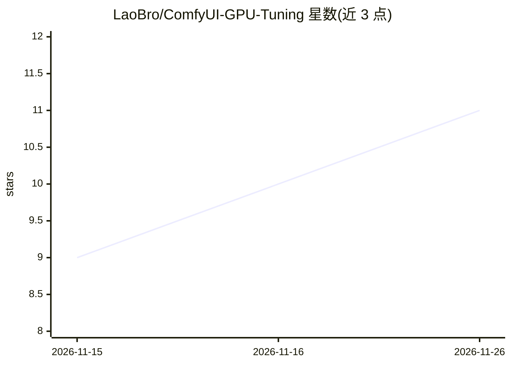

# LaoBro/ComfyUI-GPU-Tuning

⭐ 11 · Python · MIT · 推送 2026-11-25 · [GitHub](https://github.com/LaoBro/ComfyUI-GPU-Tuning) · 个人维护 · 中文 README

**为 ComfyUI 推理做实测调优的自定义节点（gfx906 一等支持）**

以 ComfyUI 自定义节点形式安装的推理调优工具：对 int8 linear、注意力内核、VAE、文本编码器与单 token 解码进行逐架构实测后启用优化，未实测的卡保持通用路径。不改 ComfyUI 源码，全部以运行时包装方式生效，环境变量 COMFY_GPU_TUNE=off 可整体关闭，设置节点改动下一次执行即生效无需重启。提供 PORTING/PATCHES/HIP_KERNELS 等文档支持移植与进一步调优，README 中标注可交由 agent 自动完成测量调优。

## 筛选速览

| 维度 | 判定 | 备注 |
|---|---|---|
| AI 角色 | `ai-ecosystem` | LLM/agent 周边工具 |
| 许可风险 | `permissive` | MIT |
| 部署形态 | `None` |  |
| 模型依赖 | — | README 未给出锁定关系 |
| 硬件要求 | — | 无带数字的原话,不猜 |
| 安装摩擦 | `low` | 无编译、无系统依赖或容器化 |
| 成熟度 | — | 结构信号不足 |

## 能力要点

- 不改 ComfyUI 源码，以运行时包装方式安装调优
- 逐架构实测决定启用哪些优化，未测过的卡保持通用路径
- 两个设置节点覆盖模型链与 CLIP 链的注意力/int8/VAE/GEMV 等参数
- 提供 HIP 内核编写与 gfx906 实测边界等移植文档

## 适用场景

- 在 MI50/gfx906 等 ROCm 卡上运行 ComfyUI 时调整推理内核
- 按自己显卡实测数据选择注意力与 int8 配置
- 需要可整体开关、不改动上游源码的调优方案

## 场景标签

`图像生成` `推理引擎` · 领域:内容生成

## 证据(README 行号)

> L3: 对 ComfyUI 的模型推理实现进行全方位测量和调优：int8 linear、注意力、VAE、
> L4: 文本编码器与单 token 解码。**不改 ComfyUI 源码**，全部以运行时包装安装，
> L17: 1. 克隆仓库到 ComfyUI 自定义节点目录

## 星数曲线

2026-11-15 9 → 2026-11-26 11（+2）

---
*卡片 v1 · prompt 1.4 · 生成 2026-11-20 · 置信度 high · 依据 README sha `f6a169289b27` · [字段定义](../../DATASET.md)*
