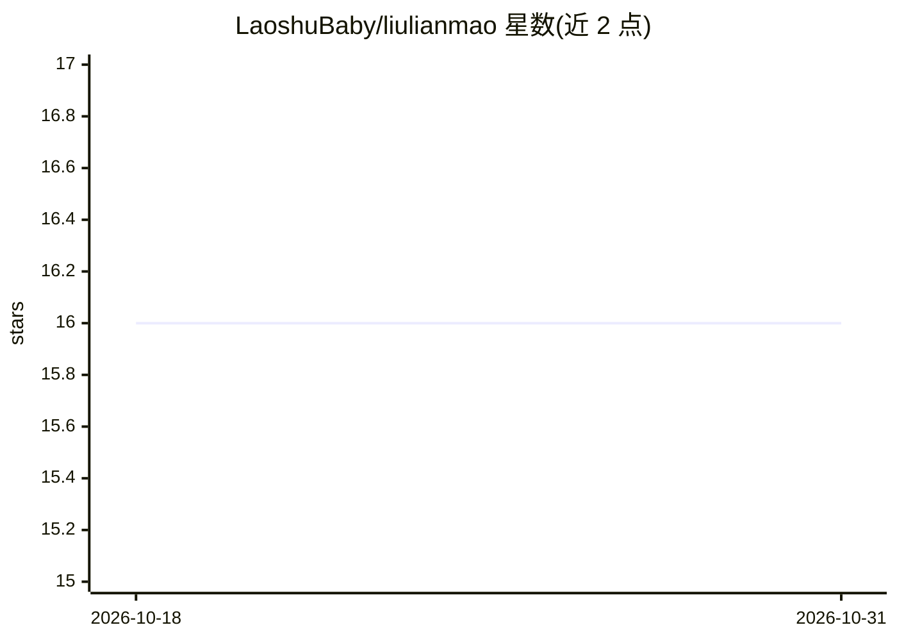

# LaoshuBaby/liulianmao

⭐ 16 · Python · MIT · 推送 2026-07-18 · [GitHub](https://github.com/LaoshuBaby/liulianmao) · [官网](https://pypi.org/project/liulianmao/) · 个人维护 · 中文 README

**命令行/IDE 中使用的大语言模型客户端**

个人开发者的 LLM 客户端工具：可在纯命令行无头调用，或在 VSCode/PyCharm 中并列多个窗口进行交互式对话；支持 restful、SDK、langchain 三条调用路径。通过环境变量配置 OPENAI_API_KEY 与 OPENAI_BASE_URL 接入 OpenAI 格式 API，具备有限的 Agent 能力（网络请求在本机执行）、recipe 组合、Prompt 仓库等特性。仅提供简体中文文档，作者自述 Agent 支持有限、跨模型适配与打包分发仍在 TODO 中。

## 筛选速览

| 维度 | 判定 | 备注 |
|---|---|---|
| AI 角色 | `ai-ecosystem` | LLM/agent 周边工具 |
| 许可风险 | `permissive` | MIT |
| 部署形态 | `library` | 以包/库形式分发 |
| 模型依赖 | — | README 未给出锁定关系 |
| 硬件要求 | — | 无带数字的原话,不猜 |
| 安装摩擦 | `low` | 无编译、无系统依赖或容器化 |
| 成熟度 | `idea` | |

## 能力要点

- 命令行无头调用与 IDE 多窗口交互式对话两种使用方式
- restful、SDK、langchain 三条路径均可展开对话
- Agent 能力：本机执行网络请求，每次判断消耗约 280-320 token
- 内置 Prompt 仓库（猫娘助理、翻译专家等，标注 token 成本）

## 适用场景

- 在命令行中无头快速调用 LLM 完成任务
- 在 IDE 内并列多窗口与模型交互式对话
- 在个人脚本或机器人项目中复用该调用代码库

## 场景标签

`AI 助手` · 领域:对话与助手

## 证据(README 行号)

> L3: **liulianmao**是@LaoshuBaby自用的一个在命令行或者IDE中使用的大语言模型客户端。本项目主要为鼠宝宝及友人提供服务，亦用作个人codebase在各种机器人和实验性项目中快速调用。
> L5: 您可脱离IDE在纯命令行中无头调用，亦可在IDE中同时并列若干窗口，运行客户端交互式对话。

## 星数曲线

2026-10-18 16 → 2026-10-31 16（+0）

---
*卡片 v1 · prompt 1.4 · 生成 2026-10-30 · 置信度 mid · 依据 README sha `258d675cb20b` · [字段定义](../../DATASET.md)*
