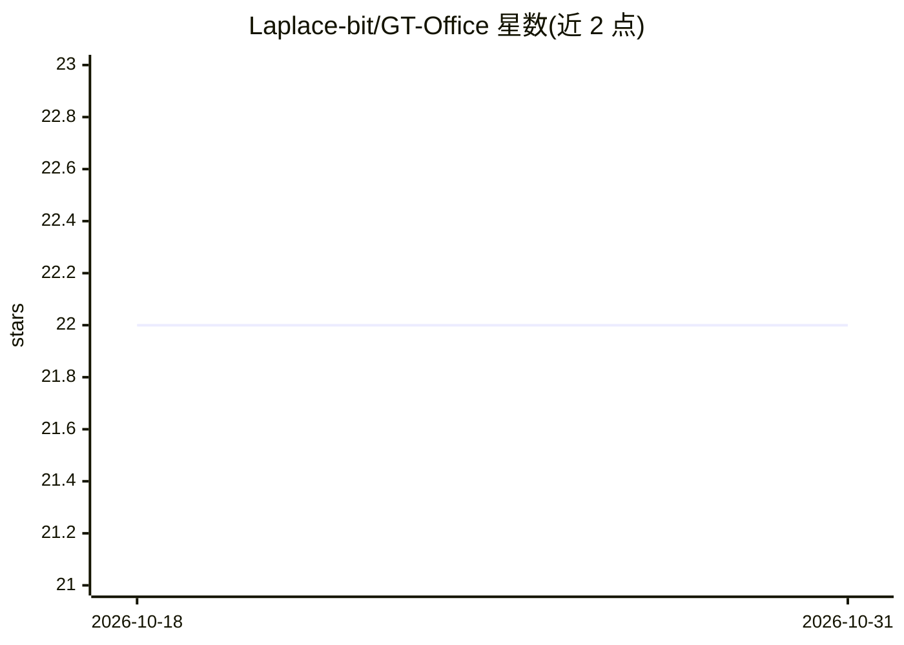

# Laplace-bit/GT-Office

⭐ 22 · TypeScript · Apache-2.0 · 推送 2026-09-02 · [GitHub](https://github.com/Laplace-bit/GT-Office) · [官网](https://laplace-bit.github.io/GT-Office/) · 个人维护 · 中文 README

**管理 Claude Code / Codex CLI 的跨平台多 agent 桌面工作台**

面向开发者的 Tauri + React + Rust 跨平台桌面应用，将 Claude Code、Codex CLI 等 AI coding agent 从终端标签页整合为统一多 agent 工作区：直接包装官方 CLI 运行，提供持久化工作区、内置 gto 命令实现 agent 间任务分发与上下文共享、Telegram/微信/飞书远程通道、任务/文件/Git 视图、Generator-Evaluator 自动评审角色与可视化切换底层模型。macOS/Windows/Linux 提供二进制发布，也可从源码构建；macOS 构建未签名需 xattr 处理，代码签名在路线图中。

## 筛选速览

| 维度 | 判定 | 备注 |
|---|---|---|
| AI 角色 | `ai-ecosystem` | LLM/agent 周边工具 |
| 许可风险 | `permissive` | Apache-2.0 |
| 部署形态 | `library` | 以包/库形式分发 |
| 模型依赖 | locked-api |  |
| 硬件要求 | — | 无带数字的原话,不猜 |
| 安装摩擦 | `low` | 无编译、无系统依赖或容器化 |
| 成熟度 | — | 结构信号不足 |

## 能力要点

- 直接包装 Claude Code / Codex CLI 官方命令行，无抽象层
- 内置 gto CLI 实现 agent 间任务分发、上下文共享与交接
- 通过 Telegram / 微信 / 飞书远程监控与指挥 agent
- 工作区级持久化：agent 与状态跨会话保留

## 适用场景

- 同时跑多个 AI coding agent 时在一个窗口统一管理
- 让多个 agent 互相派发任务、共享上下文交接工作
- 在手机上通过 Telegram/微信/飞书 查看 agent 状态并下指令

## 场景标签

`多智能体` `编码 Agent` · 领域:Agent 开发

## 证据(README 行号)

> L15: GT Office is a **cross-platform AI agent desktop app** and **multi-agent workspace** for developers. It brings **Cl
> L29: **GT Office fixes all of this.** It's a native desktop app that turns isolated CLI tools into a coordinated multi-a
> L54: - 🔌 **100% Native Integration** — Wraps official CLIs directly. No abstraction, no capability loss. Claude Code sta

## 星数曲线

2026-10-18 22 → 2026-10-31 22（+0）

---
*卡片 v1 · prompt 1.4 · 生成 2026-10-27 · 置信度 mid · 依据 README sha `32cfcfce4181` · [字段定义](../../DATASET.md)*
