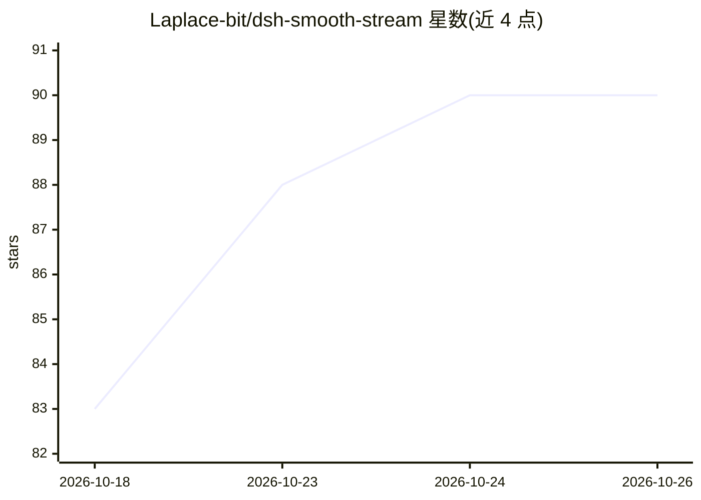

# Laplace-bit/dsh-smooth-stream

⭐ 90 · JavaScript · MIT · 推送 2026-10-18 · [GitHub](https://github.com/Laplace-bit/dsh-smooth-stream) · [官网](https://laplace-bit.github.io/dsh-smooth-stream/) · 个人维护 · 中文 README

**给 DeepSeek Harness 用户的流式渲染平滑与零重排滚动跟随插件**

面向 DeepSeek Harness（dsh）Web UI 的前端插件：将内容呈现与视口滚动拆分为两个独立物理状态机，在 rAF 中连续积分，使模型 SSE 分块输出以逐字节奏平滑揭示，滚动跟随采用二阶阻尼弹簧与 transform 位移补偿，避免重排。提供回合结束后自动折叠思考链/工具调用、对手感预设与逐项偏好的配置，附本地自动化审计脚本。兼容性按 DSH 内核版本分层声明，0.1.7 为目标内核，≤0.1.6 不在 peerDependencies 声明范围内。经 dsh plugin 命令安装。

## 筛选速览

| 维度 | 判定 | 备注 |
|---|---|---|
| AI 角色 | `ai-ecosystem` | LLM/agent 周边工具 |
| 许可风险 | `permissive` | MIT |
| 部署形态 | `None` |  |
| 模型依赖 | locked-api |  |
| 硬件要求 | — | 无带数字的原话,不猜 |
| 安装摩擦 | `medium` | 含编译或系统依赖之一 |
| 成熟度 | — | 结构信号不足 |

## 能力要点

- 揭示引擎按积压队列深度自适应调节逐字输出速度
- 二阶阻尼弹簧跟随引擎，跟随过程不读写触发 Layout 的属性
- 回合结算后自动将思考链与工具调用折叠为摘要行
- 核心 ESM 产物 Gzip 压缩后约 4.7 kB

## 适用场景

- 在 dsh Web UI 中长篇生成阅读时消除文本突发呈现与滚动抖动
- 高速代码生成场景下保持视口平稳跟随
- 对话结束后自动收敛思考过程以保持工作区专注

## 场景标签

 · 领域:LLM 界面/前端插件

## 证据(README 行号)

> L4: > 为 DeepSeek Harness（`dsh`）打造的二阶弹簧物理流式渲染与零重排跟随引擎。
> L24: `dsh-smooth-stream` 将**内容呈现**与**视口运动**拆分为两个独立的物理状态机，在每一帧动画回调（rAF）中连续积分，彻底消除跳跃感。
> L73: pnpm dsh plugin --profile web add dsh-smooth-stream

## 星数曲线

2026-10-18 83 → 2026-10-26 90（+7）

---
*卡片 v1 · prompt 1.4 · 生成 2026-10-23 · 置信度 high · 依据 README sha `6f5d3cbcb5f1` · [字段定义](../../DATASET.md)*
