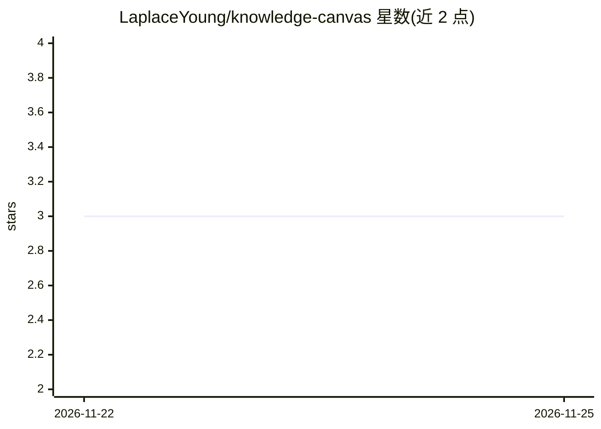

# LaplaceYoung/knowledge-canvas

⭐ 3 · TypeScript · MIT · 推送 2026-10-31 · [GitHub](https://github.com/LaplaceYoung/knowledge-canvas) · 个人维护 · 中文 README

**本地优先的无限画布 AI 学习工作台，保留问答来源脉络**

基于 React Flow 的纯 Web 应用（无 Electron/Tauri），将对话、PDF/Markdown/TXT 文档、OCR 文本与真实 AI 网页会话放在同一空间画布上；从答案或文档选中文本即可创建保留引用与来源的分支节点。模型通过 OpenAI 兼容端点接入（BYOK），Web 节点经浏览器扩展绑定 ChatGPT 等八个网页会话；OCR 走 PaddleOCR 云端或自托管 PaddleX。数据本地存储于浏览器，密钥仅存 sessionStorage；当前为 Alpha 自托管版本，不含云同步与桌面端。

## 筛选速览

| 维度 | 判定 | 备注 |
|---|---|---|
| AI 角色 | `ai-native` | 本体是模型或模型工具 |
| 许可风险 | `permissive` | MIT |
| 部署形态 | `library` | 以包/库形式分发 |
| 模型依赖 | — | README 未给出锁定关系 |
| 硬件要求 | — | 无带数字的原话,不猜 |
| 安装摩擦 | `low` | 无编译、无系统依赖或容器化 |
| 成熟度 | `idea` | |

## 能力要点

- 无限画布上做分支对话，每个追问保留引用段落与来源回溯路径
- 浏览器扩展绑定 8 个真实 AI 网页标签页，节点内直接提问并镜像消息
- PaddleOCR 云端/自托管两种 OCR 通道，识别文本锚定到页码
- BYOK：任意 OpenAI 兼容端点含本地模型服务器均可接入

## 适用场景

- 论文/扫面 PDF 阅读时围绕原文片段展开追问并保留推理链
- 同时使用多个 AI 网页服务并在同一画布管理各会话
- 用本地模型服务器离线自托管一个学习工作区

## 场景标签

`知识库管理` `文档问答` `OCR` `聊天机器人` · 领域:对话与助手

## 证据(README 行号)

> L5: **An open-source, local-first AI learning workspace built on an infinite canvas.**
> L7: Keep conversations, papers, OCR text, and live AI web sessions in one spatial workspace. Select a passage, branch fr
> L48: |**Web nodes**|Bind real ChatGPT, Claude, Gemini, Grok, DeepSeek, Doubao, Qwen, or Kimi tabs through a browser exte

## 星数曲线

2026-11-22 3 → 2026-11-25 3（+0）

---
*卡片 v1 · prompt 1.4 · 生成 2026-11-22 · 置信度 high · 依据 README sha `e84e6d78d357` · [字段定义](../../DATASET.md)*
