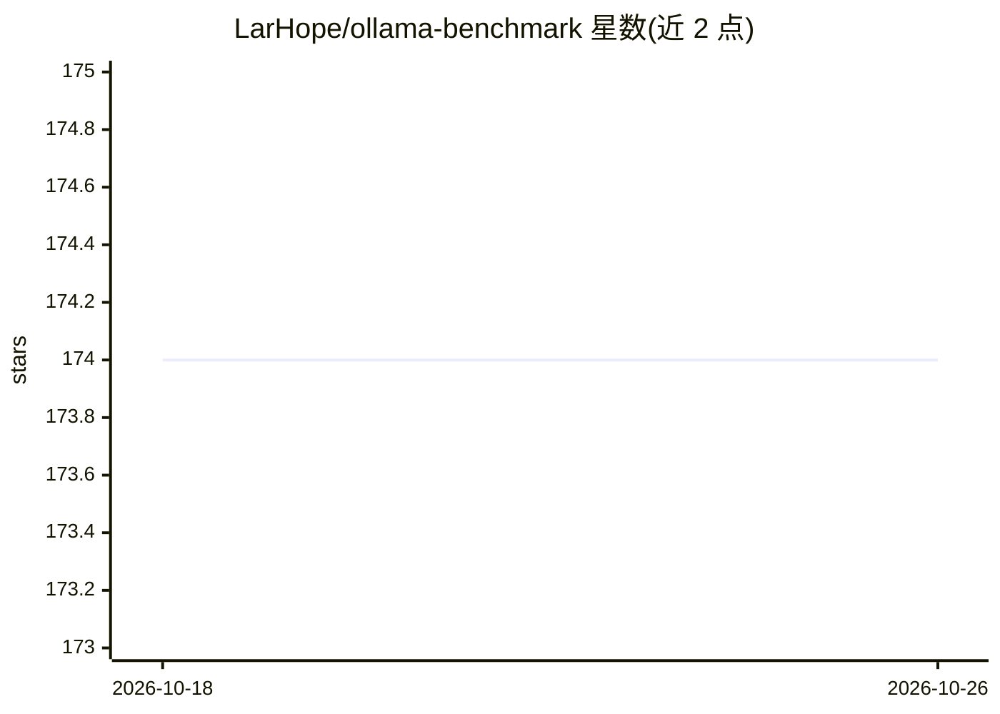

# LarHope/ollama-benchmark

⭐ 174 · Python · MIT · 推送 2026-03-30 · [GitHub](https://github.com/LarHope/ollama-benchmark) · 个人维护

**本地 Ollama 推理性能基准测试工具，输出 token/秒指标**

Python 编写的 LLM 推理基准测试 CLI 工具：连接本地 Ollama 服务端，向每个模型发送提示词，从 Ollama API 响应中采集计时指标，计算提示词处理、生成与综合吞吐的 tokens/sec，并记录模型加载时间。支持多模型单次运行对比、表格输出（-t）、自定义或内置测试提示词组（分析推理、创意写作、复杂分析、技术知识、结构化输出五类）。要求 Python 3.11+ 与已运行的 Ollama，全部本地运行，无云依赖。

## 筛选速览

| 维度 | 判定 | 备注 |
|---|---|---|
| AI 角色 | `ai-ecosystem` | LLM/agent 周边工具 |
| 许可风险 | `permissive` | MIT |
| 部署形态 | `library` | 以包/库形式分发 |
| 模型依赖 | local-ok | 支持本地模型 |
| 硬件要求 | — | 无带数字的原话,不猜 |
| 安装摩擦 | `low` | 无编译、无系统依赖或容器化 |
| 成熟度 | — | 结构信号不足 |

## 能力要点

- 提示词处理与生成的 tokens/sec 测量及综合吞吐计算
- 模型冷启动加载时间追踪
- 多模型单次运行对比与表格输出
- 内置五类默认基准提示词组

## 适用场景

- 我在本地跑多个模型，想对比推理速度再决定用哪个
- 调整硬件或参数后验证 tokens/sec 变化
- 评估 deepseek-r1 等模型在本机的加载与生成耗时

## 场景标签

`模型评测` · 领域:评测与运维

## 证据(README 行号)

> L7: A lightweight benchmarking tool for measuring LLM inference performance through Ollama. Get detailed tokens-per-seco
> L103: 3. Captures timing metrics from the Ollama API response (total duration, prompt eval, generation)

## 星数曲线

2026-10-18 174 → 2026-10-26 174（+0）

---
*卡片 v1 · prompt 1.4 · 生成 2026-10-22 · 置信度 high · 依据 README sha `ae9411ead270` · [字段定义](../../DATASET.md)*
