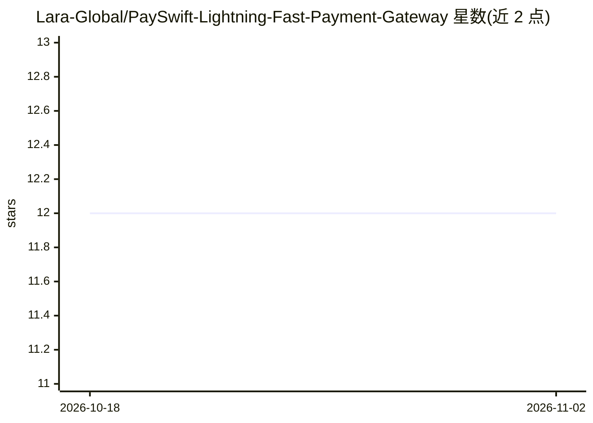

# Lara-Global/PaySwift-Lightning-Fast-Payment-Gateway

⭐ 12 · TypeScript · 推送 2026-10-25 · [GitHub](https://github.com/Lara-Global/PaySwift-Lightning-Fast-Payment-Gateway) · [官网](https://l-r.vercel.app) · 组织维护

**给开发者/企业的支付网关系统：支付处理、发票与管理后台**

基于 Node.js/Express/MongoDB 的支付网关应用，提供 RESTful API、webhook、150+ 货币支持、发票系统，以及经理/员工两级管理后台与实时分析面板。通过 git clone 源码部署，配置 MongoDB 连接、JWT 密钥与 Stripe 密钥等环境变量后运行。README 未展示可验证的 AI 功能实现细节，仅提及欺诈检测特性；部署流程宣称一键、数分钟内完成。

## 筛选速览

| 维度 | 判定 | 备注 |
|---|---|---|
| AI 角色 | `ai-enhanced` | 去掉 AI 部分产品仍成立 |
| 许可风险 | `none` | — |
| 部署形态 | `None` |  |
| 模型依赖 | — | README 未给出锁定关系 |
| 硬件要求 | — | 无带数字的原话,不猜 |
| 安装摩擦 | `low` | 无编译、无系统依赖或容器化 |
| 成熟度 | — | 结构信号不足 |

## 能力要点

- RESTful API 与实时 webhook 支付接口
- 150+ 货币支持与发票系统
- 经理/员工角色分级后台与实时分析面板
- MIT 许可，Node.js/Express/MongoDB/TypeScript 技术栈

## 适用场景

- 为自己的业务搭建支付处理与账单系统
- 通过 REST API 集成支付功能
- 团队分级管理支付与发票运营

## 场景标签

 · 领域:金融/支付

## 证据(README 行号)

> L52: |🔐 **Bank-Grade Security**|SSL encryption + fraud detection|98% fewer chargebacks|
> L84: TypeScript

## 星数曲线

2026-10-18 12 → 2026-11-02 12（+0）

---
*卡片 v1 · prompt 1.4 · 生成 2026-11-01 · 置信度 low · 依据 README sha `c4c26000e3ef` · [字段定义](../../DATASET.md)*
