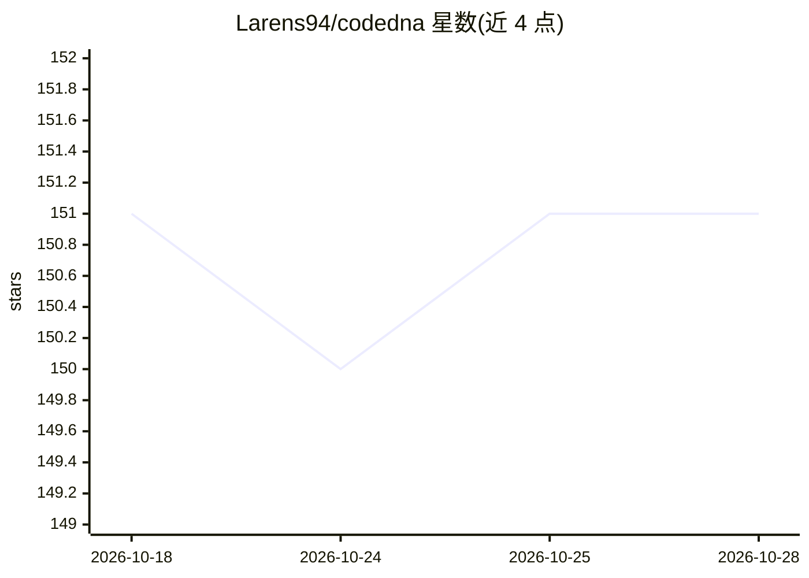

# Larens94/codedna

⭐ 151 · Python · MIT · 推送 2026-10-24 · [GitHub](https://github.com/Larens94/codedna) · [官网](https://larens94.github.io/codedna) · 个人维护

**源码内注释协议：让 AI agent 跨会话共享代码库架构上下文**

面向 AI 编程 agent 的源码内通信协议与配套 CLI：在每个文件头部写入 exports/used_by/related/rules/message 等结构化注解，使下一个 agent 只读文件头部即可获得依赖链与业务约束，减少全文件读取与重复探索。支持 --no-llm 免费结构化模式（AST/tree-sitter），或接入 LLM 生成语义规则；提供 codedna install/init/check/verify/impact 等命令、Git pre-commit 门禁与可选 wiki 同步钩子，并为 Claude Code、Codex、Cursor 等 10+ 种 agent 工具生成原生指令文件。Python 测试最充分，非 Python 适配器实战使用较少。

## 筛选速览

| 维度 | 判定 | 备注 |
|---|---|---|
| AI 角色 | `ai-ecosystem` | LLM/agent 周边工具 |
| 许可风险 | `permissive` | MIT |
| 部署形态 | `library` | 以包/库形式分发 |
| 模型依赖 | local-ok | 支持本地模型 |
| 硬件要求 | — | 无带数字的原话,不猜 |
| 安装摩擦 | `low` | 无编译、无系统依赖或容器化 |
| 成熟度 | `idea` | |

## 能力要点

- 文件头部结构化注解（exports/used_by/rules/message）跨会话传递架构上下文
- --no-llm 免费结构化路径（AST/tree-sitter），或 --model 接入 LLM 生成语义规则
- 为 Claude Code/Codex/Cursor 等 10+ 种 agent 工具生成原生指令文件与 Git 钩子
- 12+ 种语言自动检测（Python 最成熟，非 Python 适配器实战较少）

## 适用场景

- 多 agent 协作开发时避免重复探索代码库约束
- 在 CI 中用 codedna check/verify 检查注解覆盖率与过期引用
- 编辑前用 codedna impact 查看依赖链与传递调用方

## 场景标签

`Agent 记忆` · 领域:Agent 开发

## 证据(README 行号)

> L22: An in-source communication protocol where AI agents embed architectural context directly in the files they write. T
> L50: pipx install git+https://github.com/Larens94/codedna.git   # requires Python 3.11+; isolated install (avoids global
> L88: codedna init . --model deepseek/deepseek-chat  # with LLM rules: (~$0.40 for 200 files)

## 星数曲线

2026-10-18 151 → 2026-10-28 151（+0）

---
*卡片 v1 · prompt 1.4 · 生成 2026-10-22 · 置信度 mid · 依据 README sha `ef4687defdec` · [字段定义](../../DATASET.md)*
