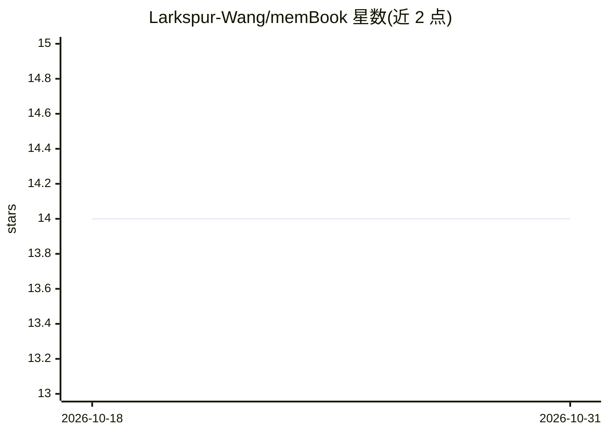

# Larkspur-Wang/memBook

⭐ 14 · Python · MIT · 推送 2026-04-11 · [GitHub](https://github.com/Larkspur-Wang/memBook) · [官网](https://github.com/Larkspur-Wang/memBook) · 个人维护 · 中文 README

**给 AI Agent 用的渐进式长期记忆层**

为 AI Agent 提供长期记忆能力的 Python 库：记忆以 Header+Content 两层结构写入，召回时先加载轻量记忆头，再按 token 预算渐进式扩展正文，并支持沿关系图做链式（second-hop）扩展。召回策略组合 lexical/vector/graph/time 四路混合，输出可解释的分数拆解与关系证据。文件优先治理：YAML 索引 + Markdown 正文，提供健康检查、文件同步、向量重建工具，以及写入安全护栏。统一入口含 Python API、CLI、REST API 与 MCP server。默认配置为文件模式，不依赖外部 embedding 服务。历史 benchmark 数字来自旧仓库 pinned 快照，公开仓库不含完整 benchmark harness。

## 筛选速览

| 维度 | 判定 | 备注 |
|---|---|---|
| AI 角色 | `ai-ecosystem` | LLM/agent 周边工具 |
| 许可风险 | `permissive` | MIT |
| 部署形态 | `library` | 以包/库形式分发 |
| 模型依赖 | — | README 未给出锁定关系 |
| 硬件要求 | — | 无带数字的原话,不猜 |
| 安装摩擦 | `low` | 无编译、无系统依赖或容器化 |
| 成熟度 | — | 结构信号不足 |

## 能力要点

- Header+Content 双层记忆与按 token 预算的渐进式加载
- lexical/vector/graph/time 混合召回与 relation-hop 链式扩展
- 文件后端治理：health-check、sync-files、rebuild-vector-index
- 统一入口：Python API、CLI、REST API、MCP server

## 适用场景

- 为我的 Agent 增加可控成本的长期记忆能力
- 多会话、长时序、多关系场景下做链式记忆召回
- 需要人工可读、可审计（Markdown/YAML）的记忆存储

## 场景标签

`Agent 记忆` · 领域:Agent 开发

## 证据(README 行号)

> L13: 给 AI Agent 用的渐进式长期记忆层。
> L133: - 统一入口：Python API、`membook` CLI、REST API、MCP server。

## 星数曲线

2026-10-18 14 → 2026-10-31 14（+0）

---
*卡片 v1 · prompt 1.4 · 生成 2026-10-31 · 置信度 high · 依据 README sha `9bbe8bf90e86` · [字段定义](../../DATASET.md)*
