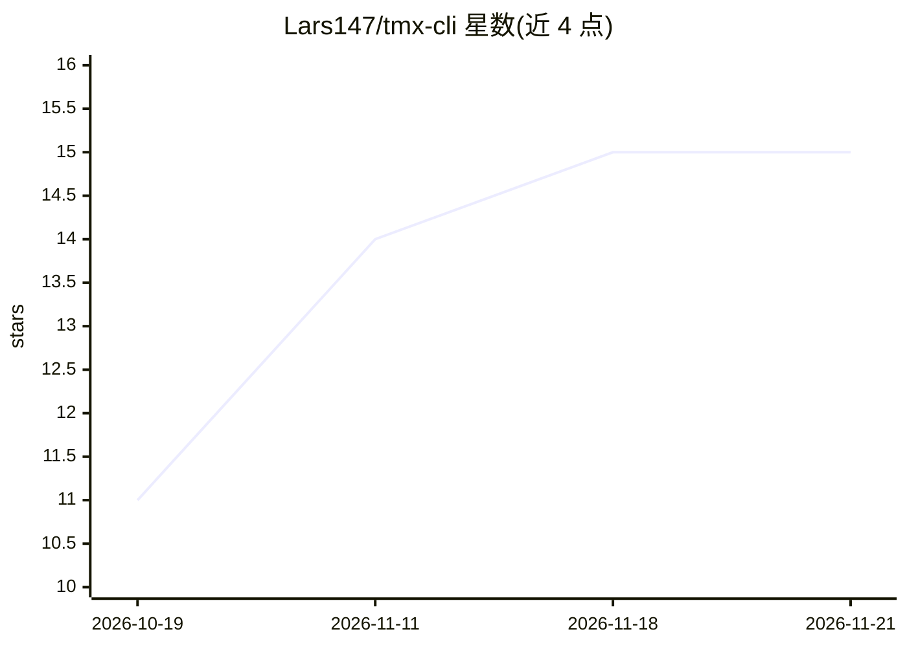

# Lars147/tmx-cli

⭐ 15 · Python · MIT · 推送 2026-10-29 · [GitHub](https://github.com/Lars147/tmx-cli) · 个人维护

**终端操作 Cookidoo/Thermomix 的纯 Python CLI：食谱搜索与周餐计划**

非官方的 Cookidoo 客户端命令行工具：通过 Vorwerk/Cidaas OAuth 登录账号，支持查看/同步/添加周餐计划、检索 24,000+ 食谱（含时间/难度/类别过滤与饮食偏好配置）、收藏管理、食谱详情（食材/步骤/营养）与购物清单生成导出（Markdown/JSON）。仅依赖 Python 标准库，数据以本地 JSON 文件缓存。文本化命令与可解析输出便于 Claude Code、Codex、OpenClaw 等 AI 助手调用以代为操作餐计划。声明与 Vorwerk 无关联、需遵守 Cookidoo 服务条款。

## 筛选速览

| 维度 | 判定 | 备注 |
|---|---|---|
| AI 角色 | `ai-enhanced` | 去掉 AI 部分产品仍成立 |
| 许可风险 | `permissive` | MIT |
| 部署形态 | `None` |  |
| 模型依赖 | — | README 未给出锁定关系 |
| 硬件要求 | — | 无带数字的原话,不猜 |
| 安装摩擦 | `low` | 无编译、无系统依赖或容器化 |
| 成熟度 | — | 结构信号不足 |

## 能力要点

- OAuth 登录 Cookidoo 账号并同步周餐计划
- 检索 24,000+ 食谱，支持时间/难度/类别过滤
- 自动生成购物清单并可导出 Markdown/JSON
- 零依赖，纯 Python 标准库实现

## 适用场景

- 在终端里管理 Thermomix 周餐计划与收藏
- 快速搜索食谱并生成购物清单
- 让 Claude Code 等 AI 助手通过命令代为安排餐计划

## 场景标签

 · 领域:生活工具/烹饪自动化

## 证据(README 行号)

> L20: **tmx-cli** brings Cookidoo® to your terminal. No more browser hassle — manage your weekly meal plan, search 24,000
> L49: |🤖 **AI-Agent Friendly**|Perfect for Claude, Codex, OpenClaw & other AI assistants|
> L53: The CLI approach makes tmx-cli ideal for AI coding assistants like **Claude Code**, **Codex**, or **OpenClaw**. Tex

## 星数曲线

2026-10-19 11 → 2026-11-21 15（+4）

---
*卡片 v1 · prompt 1.4 · 生成 2026-11-18 · 置信度 high · 依据 README sha `8a523321fbc4` · [字段定义](../../DATASET.md)*
