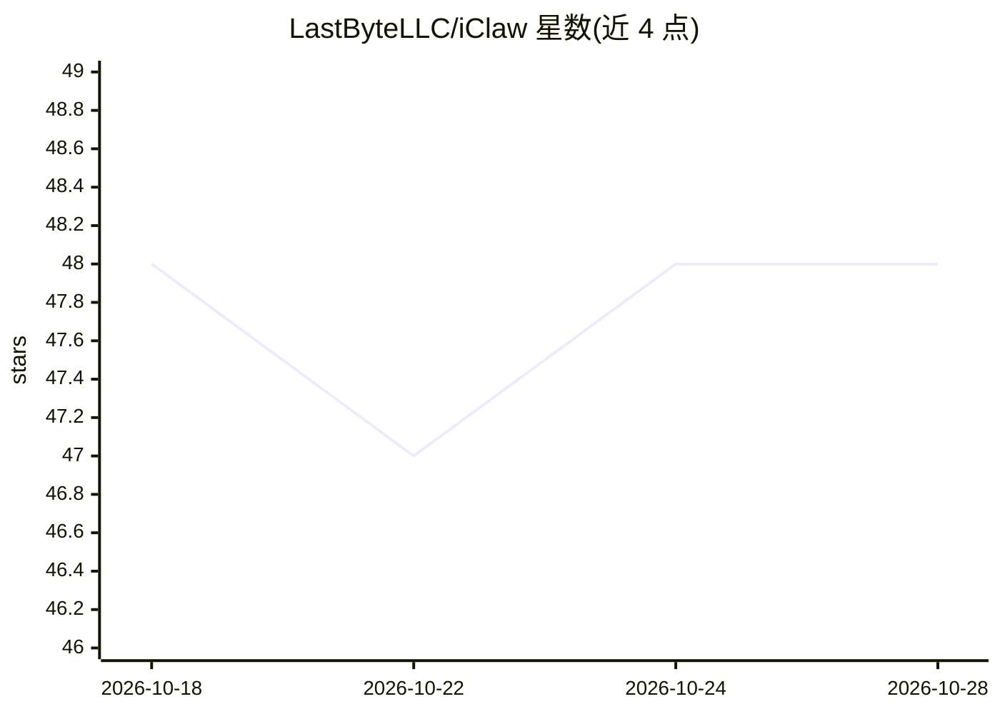

# LastByteLLC/iClaw

⭐ 48 · Swift · AGPL-3.0 · 推送 2026-04-27 · [GitHub](https://github.com/LastByteLLC/iClaw) · [官网](https://geticlaw.com) · 组织维护

**macOS 本地原生 AI agent，用 Apple Intelligence 或 Ollama 设备端运行**

Swift 编写的 macOS 26+ 菜单栏 AI agent（iOS 版在路线图中），推理全部在本机通过 Apple Intelligence 或 Ollama 完成，无需 API key 或订阅。内置约 30 个确定性工具（天气、日历、邮件、消息、播客转录、系统控制等）与用户可扩展技能；采用 ML 分类器按置信度路由到单工具、计划分解或多轮 agent 推理三条执行路径，配三级渐进记忆与 4K token 预算。通过 make 命令从源码构建，无预编译安装包。曾内置的 LoRA 适配器已移除。

## 筛选速览

| 维度 | 判定 | 备注 |
|---|---|---|
| AI 角色 | `ai-native` | 本体是模型或模型工具 |
| 许可风险 | `viral` | AGPL-3.0 |
| 部署形态 | `desktop` | 安装包/桌面程序 |
| 模型依赖 | local-ok | 支持本地模型 |
| 硬件要求 | — | 无带数字的原话,不猜 |
| 安装摩擦 | `low` | 无编译、无系统依赖或容器化 |
| 成熟度 | — | 结构信号不足 |

## 能力要点

- 推理 100% 设备端（Apple Intelligence 或 Ollama），无 API key
- 约 30 个内置工具（天气/日历/邮件/转录/系统控制等）加用户可扩展技能
- ML 分类器三路径路由：单工具快路径 / 计划分解 / 多轮 agent 推理
- 三级渐进记忆与 4K token 预算控制上下文

## 适用场景

- 在菜单栏用自然语言查天气、日程、股票、做研究等日常任务
- 离线私密地执行发消息、建日程、读写笔记等系统操作
- 在不依赖云 API 的前提下跑多步 agent 任务

## 场景标签

`AI 助手` · 领域:对话与助手

## 证据(README 行号)

> L20: **iClaw** is a local, native AI agent for macOS 26+ (and soon iOS 26+) written in Swift. It runs on-device using Ap
> L46: * **100% On-Device** — All inference runs locally using Apple Intelligence or Ollama. Network is only used for fetc

## 星数曲线

2026-10-18 48 → 2026-10-28 48（+0）

---
*卡片 v1 · prompt 1.4 · 生成 2026-10-25 · 置信度 high · 依据 README sha `d090d822b863` · [字段定义](../../DATASET.md)*
