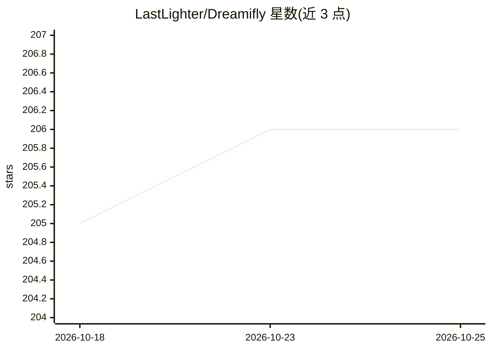

# LastLighter/Dreamifly

⭐ 206 · TypeScript · 推送 2026-07-13 · [GitHub](https://github.com/LastLighter/Dreamifly) · [官网](https://imagifly.net/) · 个人维护 · 中文 README

**基于 Next.js 与 ComfyUI API 的 AI 图像生成 Web 平台**

基于 Next.js 15 构建的开源 AI 绘画网站模板，通过调用 ComfyUI 后端 API 实现文生图与图生图，支持 HiDream、Flux、Stable Diffusion 3.5、Qwen-Image 等 8 种模型。提供匿名使用、中文提示词经 LLM 自动转英文、风格转换、每日生成统计与中英文界面。后端需自行部署 ComfyUI 服务并配置各模型独立 API 端点，数据库使用 PostgreSQL。支持本地开发、Docker 与 Docker Compose 部署，可作二次开发模板。

## 筛选速览

| 维度 | 判定 | 备注 |
|---|---|---|
| AI 角色 | `ai-native` | 本体是模型或模型工具 |
| 许可风险 | `none` | — |
| 部署形态 | `self-host` | docker 或自建部署 |
| 模型依赖 | — | README 未给出锁定关系 |
| 硬件要求 | — | 无带数字的原话,不猜 |
| 安装摩擦 | `low` | 无编译、无系统依赖或容器化 |
| 成熟度 | — | 结构信号不足 |

## 能力要点

- 通过 ComfyUI API 支持 8 种模型（HiDream/Flux/Stable Diffusion 3.5/Qwen-Image 等）
- 文生图与图生图（1-2 张参考图），支持批量生成 1-4 张与多参数调节
- 中文提示词经 LLM 自动优化为英文，无需登录匿名使用
- 中英文界面、每日生成统计（PostgreSQL 存储）

## 适用场景

- 快速部署个人 AI 图像生成站点
- 作为 AI 绘画平台二次开发的项目模板
- 搭配自建 ComfyUI 服务提供文生图/图生图能力

## 场景标签

`图像生成` · 领域:内容生成

## 证据(README 行号)

> L5: > **Dreamifly** 是一个基于 **Next.js** 与 **ComfyUI API** 的开源 AI 图像生成平台，支持文生图（Text-to-Image）和图生图（Image-to-Image），无需注册，专为开发
> L9: Dreamifly 是一个轻量级、高性能的 AI 绘画网站模板，集成多种先进 AI 模型（如 **HiDream-I1**、**Flux.1-Dev**、**Stable Diffusion 3.5**、**Qwen-Image**

## 星数曲线

2026-10-18 205 → 2026-10-25 206（+1）

---
*卡片 v1 · prompt 1.4 · 生成 2026-10-22 · 置信度 high · 依据 README sha `e3f2c8bc2aa8` · [字段定义](../../DATASET.md)*
