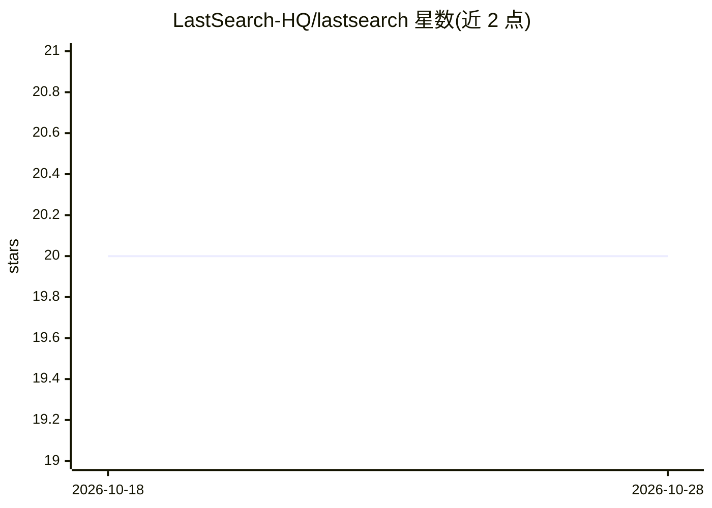

# LastSearch-HQ/lastsearch

⭐ 20 · TypeScript · Apache-2.0 · 推送 2026-10-27 · [GitHub](https://github.com/LastSearch-HQ/lastsearch) · [官网](https://lastsearch.ai) · 个人维护

**面向 AI agent 的证据支撑网络搜索基础设施：检索+核验+引用**

为 AI agent 提供研究基础设施的服务：网页搜索、抓取、神经重排、声明抽取与逐条核验，输出带结构化引用与置信度分数的回答。核验流水线含原子声明分解、混合检索、专用重排模型、跨源共识、矛盾检测、引用健康检查、内容完整性扫描与 Ed25519 签名的证据记录。提供 REST API、Python SDK、npm 包与 LangChain 集成包；deep 模式与语义核验需 LastSearch API key，无 key 时回退到纯关键词核验。

## 筛选速览

| 维度 | 判定 | 备注 |
|---|---|---|
| AI 角色 | `ai-ecosystem` | LLM/agent 周边工具 |
| 许可风险 | `permissive` | Apache-2.0 |
| 部署形态 | `library` | 以包/库形式分发 |
| 模型依赖 | — | README 未给出锁定关系 |
| 硬件要求 | — | 无带数字的原话,不猜 |
| 安装摩擦 | `low` | 无编译、无系统依赖或容器化 |
| 成熟度 | — | 结构信号不足 |

## 能力要点

- 逐声明对照原文核验，输出 verified/verificationScore/consensusLevel 等结构化字段
- 16 步核验流水线：原子声明分解、跨源共识、矛盾检测、反例查询、迭代置信度门控检索
- 引用健康检查（live/stale/dead）与 Ed25519 签名的可回放证据记录
- fast/thorough/deep 三档研究深度模式，deep 为多步 agentic 研究循环

## 适用场景

- 为 AI agent 接入带引用与置信度的实时网络搜索
- 事实核查与重要研究场景下逐声明验证回答
- 构建可审计的深度研究 agent，保留可回放证据链

## 场景标签

`语义搜索` `网页抓取` · 领域:效率与自动化

## 证据(README 行号)

> L9: **Research infrastructure for AI agents with Grounded Intelligence** — real-time web search, evidence extraction, ve
> L12: Agent → LastSearch → Internet → Verified answers + sources
> L24: search → fetch pages → neural rerank → extract claims → verify → cited answer (streamed)

## 星数曲线

2026-10-18 20 → 2026-10-28 20（+0）

---
*卡片 v1 · prompt 1.4 · 生成 2026-10-28 · 置信度 high · 依据 README sha `63aaa25b4ec2` · [字段定义](../../DATASET.md)*
