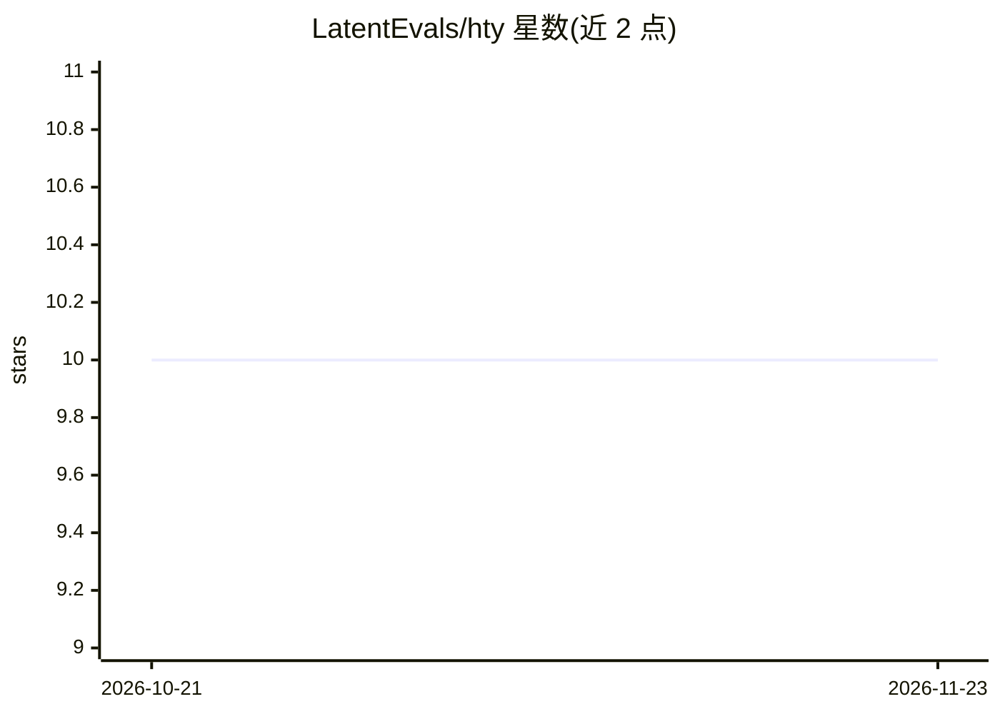

# LatentEvals/hty

⭐ 10 · Zig · 推送 2026-09-01 · [GitHub](https://github.com/LatentEvals/hty) · [官网](https://hty.sh) · 组织维护

**让 AI agent 驱动真实交互式 TUI/CLI 程序的无头终端**

hty 将任意交互式程序包装进持久 PTY 会话，agent 以读取渲染画面、发送按键的方式操作 vim、psql、git add -p 等程序。后台服务器经 Unix socket 管理会话，跨调用持久存在，多个工具可并发驱动同一会话；提供 --text/--regex/--idle/--exit 等等待原语、JSONL 全量录制与 replay 回放、hty watch 实时只读观察，以及经 SSH 隧道的远程观察。单二进制、零运行时依赖，文档提供 llms.txt 供 agent 摄取。

## 筛选速览

| 维度 | 判定 | 备注 |
|---|---|---|
| AI 角色 | `ai-ecosystem` | LLM/agent 周边工具 |
| 许可风险 | `none` | — |
| 部署形态 | `desktop` | 安装包/桌面程序 |
| 模型依赖 | — | README 未给出锁定关系 |
| 硬件要求 | — | 无带数字的原话,不猜 |
| 安装摩擦 | `low` | 无编译、无系统依赖或容器化 |
| 成熟度 | — | 结构信号不足 |

## 能力要点

- 持久 PTY 会话，跨调用存活，多工具并发驱动
- 等待原语（--text/--regex/--idle/--exit）配合 --snapshot 实现单往返 agent 循环
- JSONL 追加式录制，支持 replay 回放与 asciicast/GIF/MP4 导出
- 基于 Ghostty VT 引擎，单二进制零运行时依赖

## 适用场景

- 让 coding agent 处理 git add -p 等交互式工作流
- agent 自动化 gh auth login、create-next-app 等交互式安装流程
- 在 CI 中驱动 TUI 程序并录制回放
- 通过另一终端或 SSH 隧道实时观察 agent 的终端操作

## 场景标签

`编码 Agent` · 领域:编码与开发

## 证据(README 行号)

> L5:  Puppeteer for the terminal. Drive any interactive CLI with AI.
> L25: `hty` wraps any interactive program in a persistent PTY session. Your agent reads the rendered terminal the way you
> L35: **Using an AI agent?** Install the hty agent skill so Claude Code, Codex, Cursor, Gemini, and others know when and 

## 星数曲线

2026-10-21 10 → 2026-11-23 10（+0）

---
*卡片 v1 · prompt 1.4 · 生成 2026-11-20 · 置信度 mid · 依据 README sha `5d9a3aa8a221` · [字段定义](../../DATASET.md)*
