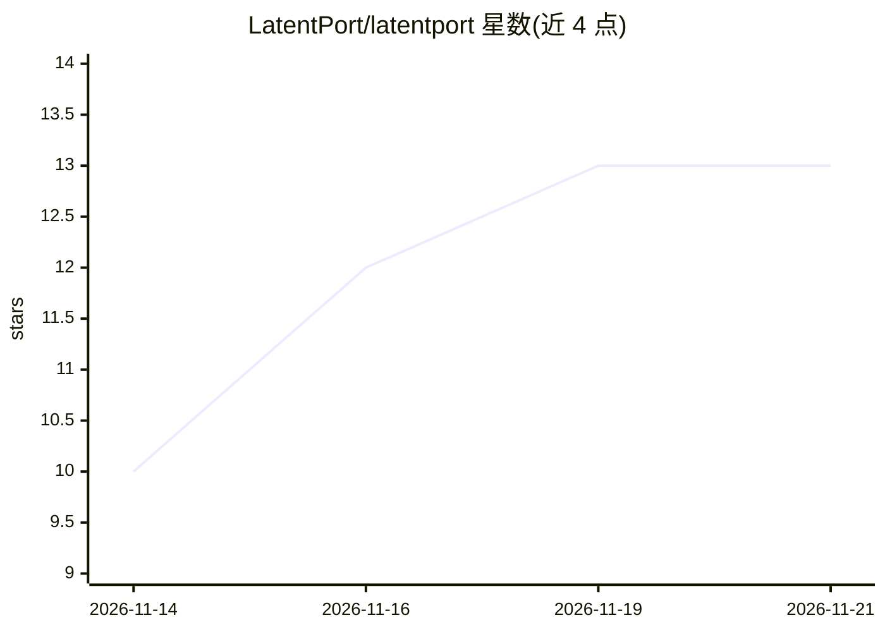

# LatentPort/latentport

⭐ 13 · Python · Apache-2.0 · 推送 2026-11-20 · [GitHub](https://github.com/LatentPort/latentport) · [官网](https://latentport.com) · 个人维护

**让 LLM 推理内部状态可编程：迁移、压缩、分叉上下文**

Python 运行时库，将模型推理状态（KV/循环记忆/位置）变为可操作对象：捕获上下文、经训练的 bridge 在模型对之间迁移状态、按比例压缩注意力 KV、分叉分支、保存/恢复而无需重放历史。提供 capture/transfer/compact/fork/save 等统一 API、NF4/BF16/GGUF 后端与缓存交接会话策略。仅支持目录中的特定检查点（以 Qwen 系列为主），每个 bridge 有向且绑定精确版本；推理需 CUDA PyTorch。面向做长上下文推理与多模型协作的开发者与研究者。

## 筛选速览

| 维度 | 判定 | 备注 |
|---|---|---|
| AI 角色 | `ai-ecosystem` | LLM/agent 周边工具 |
| 许可风险 | `permissive` | Apache-2.0 |
| 部署形态 | `library` | 以包/库形式分发 |
| 模型依赖 | local-ok | 支持本地模型 |
| 硬件要求 | — | 无带数字的原话,不猜 |
| 安装摩擦 | `medium` | 含编译或系统依赖之一 |
| 成熟度 | — | 结构信号不足 |

## 能力要点

- bridge.translate() 在支持的模型对间迁移推理状态，无需重放历史上下文
- state.compact() 压缩注意力 KV 并保留循环记忆、卷积状态与逻辑位置
- state.fork()/save()/load() 支持分支与恢复，快照记录精确模型与运行时身份
- NF4/BF16/GGUF 三种后端，GGUF 需配套原生库

## 适用场景

- 把小模型的对话上下文迁移到大模型继续回答，避免重新 prefill
- 128K 长会话中压缩 KV 存储以腾出上下文空间
- 同一份上下文分叉给多个 agent 各自推进
- 保存会话状态后中断并恢复，跳过历史重放

## 场景标签

`推理引擎` `Agent 记忆` · 领域:Agent 开发

## 证据(README 行号)

> L3: **LatentPort makes LLM internal states programmable.**
> L7: Capture a model's working context, transfer it to another model, compact its
> L9: operate on inference state so supported models can continue without replaying

## 星数曲线

2026-11-14 10 → 2026-11-21 13（+3）

---
*卡片 v1 · prompt 1.4 · 生成 2026-11-18 · 置信度 high · 依据 README sha `1039869d0301` · [字段定义](../../DATASET.md)*
