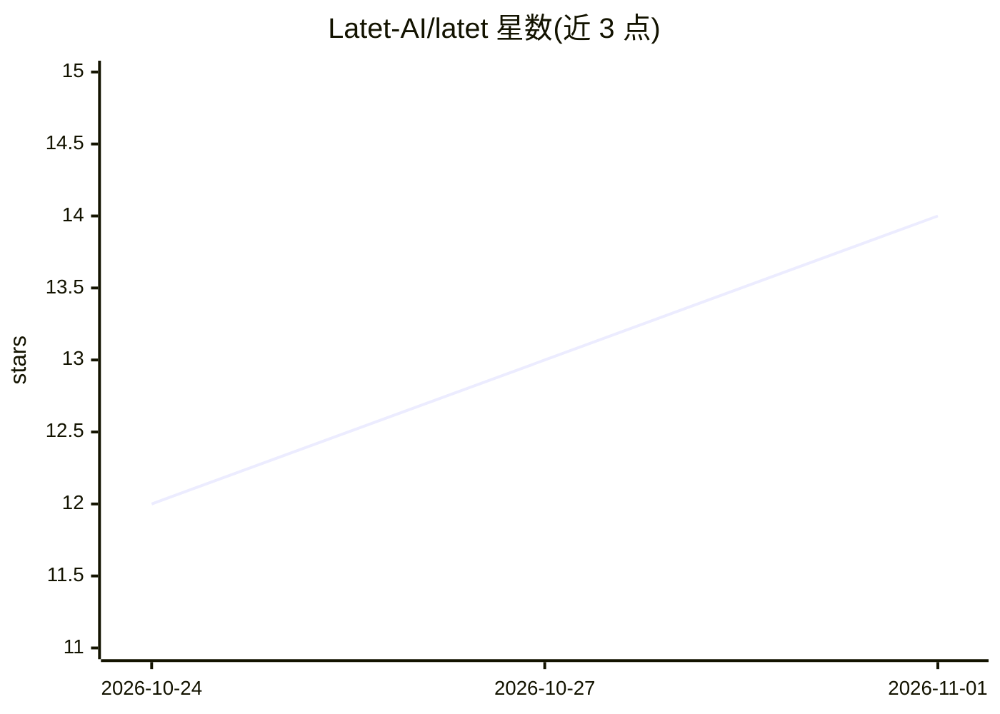

# Latet-AI/latet

⭐ 14 · Python · NOASSERTION · 推送 2026-10-29 · [GitHub](https://github.com/Latet-AI/latet) · [官网](https://latet.ai) · 组织维护

**本地隐私防火墙：AI agent 请求出站前掩码敏感数据**

部署在 agent 与云端模型之间的本地代理：请求离开本机前检测并替换密钥与个人数据为同形假值，回答返回时本地还原真值。覆盖提示词、文件、命令输出、数据库查询、截图等输入面；可选本地语言模型审查器（经 llama.cpp/Ollama/LM Studio 运行）与人工审批面板处理无固定格式的敏感信息。支持 Claude Code 插件模式与 OpenAI 兼容网关模式，接入 Codex、OpenCode、Gemini CLI 等多种 agent；另提供 HTTP API、Python SDK 与 n8n 节点。全程在本机运行，无云服务与遥测。

## 筛选速览

| 维度 | 判定 | 备注 |
|---|---|---|
| AI 角色 | `ai-ecosystem` | LLM/agent 周边工具 |
| 许可风险 | `none` | NOASSERTION |
| 部署形态 | `self-host` | docker 或自建部署 |
| 模型依赖 | local-ok | 支持本地模型 |
| 硬件要求 | — | 无带数字的原话,不猜 |
| 安装摩擦 | `low` | 无编译、无系统依赖或容器化 |
| 成熟度 | — | 结构信号不足 |

## 能力要点

- 确定性同形假值替换与本地还原，跨会话一致
- 本地 LLM 审查器捕获无模式敏感信息，配合 Live Reviewer 人工审批
- Claude Code 插件模式与 OpenAI 兼容网关模式覆盖多种 agent 与 SDK
- latet.yaml 按项目自定义识别规则且只能加强保护

## 适用场景

- 让 Claude Code/Codex 等编码 agent 处理客户数据时避免明文上传
- 企业经 Bedrock/Vertex/Azure 网关使用模型前做脱敏
- 对无人值守的自主 agent 输出内容做出境前审批

## 场景标签

`网络安全` · 领域:学习与行业

## 证据(README 行号)

> L10: Latet stands between the agent and the model. It masks secrets and personal data before a request
> L173: |Hermes Agent, OpenClaw, Goose, OpenHands, and any agent that takes an OpenAI-compatible base URL|Gateway: its bas
> L174: |Scripts and SDKs: the OpenAI, Anthropic and Google GenAI SDKs, LangChain, LangGraph, AutoGen, CrewAI, Aider, etc.

## 星数曲线

2026-10-24 12 → 2026-11-01 14（+2）

---
*卡片 v1 · prompt 1.4 · 生成 2026-10-31 · 置信度 high · 依据 README sha `21a5ea03d1ad` · [字段定义](../../DATASET.md)*
