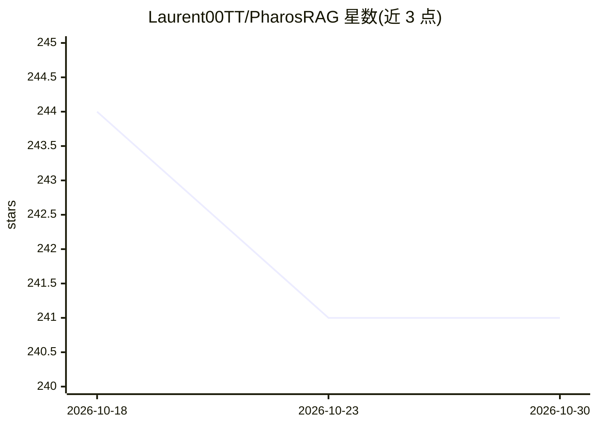

# Laurent00TT/PharosRAG

⭐ 241 · Python · MIT · 推送 2026-08-19 · [GitHub](https://github.com/Laurent00TT/PharosRAG) · 个人维护 · 中文 README

**团队文档库的本地 RAG 问答系统：多格式入库、混合检索、企业权限**

面向团队部署的本地优先 RAG 系统：将 PDF、扫描件、docx/pptx/xlsx 解析为知识库，提供 HTTP API（/v1/ask 闭环问答含引用与 6 个检索端点）和 MCP 两个出口，MCP 供 Claude Code 等 agent 做 agentic RAG。身份由服务端 X-API-Key 决定，检索层按租户/主体做 ACL 硬过滤，全程 fail-closed，默认仅绑定 127.0.0.1。常驻守护进程持有嵌入式 Qdrant 与 GPU 模型，可拆为 inference/pharos/Qdrant 三层用 docker compose 多副本扩展。文档为中文（12 篇 RAG 教程），HTTPS 与公网暴露为明确非目标。

## 筛选速览

| 维度 | 判定 | 备注 |
|---|---|---|
| AI 角色 | `ai-native` | 本体是模型或模型工具 |
| 许可风险 | `permissive` | MIT |
| 部署形态 | `self-host` | docker 或自建部署 |
| 模型依赖 | locked-api |  |
| 硬件要求 | — | 无带数字的原话,不猜 |
| 安装摩擦 | `low` | 无编译、无系统依赖或容器化 |
| 成熟度 | — | 结构信号不足 |

## 能力要点

- HTTP API 与 MCP 双出口共享同一工具契约（toolcore 单一来源）
- 多身份 keys 模式与检索层 ACL 硬过滤，五用户矩阵回归验证
- 常驻 daemon 持有嵌入式 Qdrant 与 GPU 模型，MCP 适配层毫秒级启动
- 三层拆分架构支持 docker compose --scale pharos=3 多副本
- 附 12 篇中文 RAG 学习/面试教程（4,122 行）

## 适用场景

- 团队把内部文档建成可问答、带页级引用的知识库
- 让 Claude Code 等 agent 通过 MCP 工具做 agentic 检索
- 多租户/多身份企业部署中按权限过滤检索结果

## 场景标签

`RAG` `文档问答` `教程课程` · 领域:知识与检索

## 证据(README 行号)

> L11: **Turn PDFs, scans, docx, pptx and xlsx into a local knowledge base you can ask questions of — with enterprise acce
> L30: |**HTTP API**|`pharos serve`|curl, scripts, frontends|Closed-pipeline QA: `/v1/ask` runs retrieve → grounding → Dee
> L31: |**MCP**|`pharos mcp`|agents such as Claude Code|Agentic RAG: when to retrieve, how to rewrite, whether to go multi

## 星数曲线

2026-10-18 244 → 2026-10-30 241（-3）

---
*卡片 v1 · prompt 1.4 · 生成 2026-10-22 · 置信度 high · 依据 README sha `a2f90e2c9fbf` · [字段定义](../../DATASET.md)*
