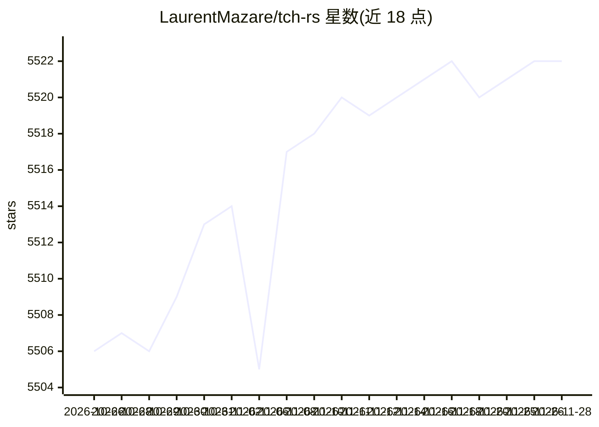

# LaurentMazare/tch-rs

⭐ 5,522 · Rust · Apache-2.0 · 推送 2026-11-10 · [GitHub](https://github.com/LaurentMazare/tch-rs) · 个人维护

**PyTorch C++ API 的 Rust 绑定库，用 Rust 训练和运行模型**

对 libtorch（PyTorch C++ API）提供接近原 API 的薄封装，支持张量运算、自动微分、nn 模块定义与 SGD/Adam 等优化器训练。附带的示例覆盖 MNIST 训练、ResNet/CIFAR-10、char-rnn、神经风格迁移、强化学习、minGPT 与 Stable Diffusion 实现，并提供 TorchScript 部署教程。依赖系统中的 libtorch v2.15.0，可通过系统安装、Python PyTorch 环境或 download-libtorch 特性下载预编译二进制接入，支持 CUDA 版本选择与静态链接。

## 筛选速览

| 维度 | 判定 | 备注 |
|---|---|---|
| AI 角色 | `ai-native` | 本体是模型或模型工具 |
| 许可风险 | `permissive` | Apache-2.0 |
| 部署形态 | `library` | 以包/库形式分发 |
| 模型依赖 | — | README 未给出锁定关系 |
| 硬件要求 | — | 无带数字的原话,不猜 |
| 安装摩擦 | `medium` | 含编译或系统依赖之一 |
| 成熟度 | — | 结构信号不足 |

## 能力要点

- 对 libtorch C++ API 的薄封装，接口贴近原 C++ API
- 支持从 PyTorch 导出的 safetensors 权重导入
- 预训练模型示例：ResNet 图像分类、VGG-16 风格迁移、TorchScript 部署
- 支持 LIBTORCH_STATIC 静态链接与 CUDA 预编译二进制（cu117）

## 适用场景

- 在 Rust 项目中执行张量运算与梯度下降训练模型
- 加载 Python 训练的权重在 Rust 中推理
- 在 Rust 中复现 minGPT、Stable Diffusion 等模型实现

## 场景标签

`模型训练` · 领域:训练与推理

## 证据(README 行号)

> L2: Rust bindings for the C++ api of PyTorch. The goal of the `tch` crate is to
> L97: This crate provides a tensor type which wraps PyTorch tensors. Here is a minimal
> L134: The `nn` api can be used to create neural network architectures, e.g. the following code defines

## 星数曲线

2026-10-26 5,506 → 2026-11-28 5,522（+16）

---
*卡片 v1 · prompt 1.4 · 生成 2026-11-22 · 置信度 mid · 依据 README sha `a431f1a27861` · [字段定义](../../DATASET.md)*
