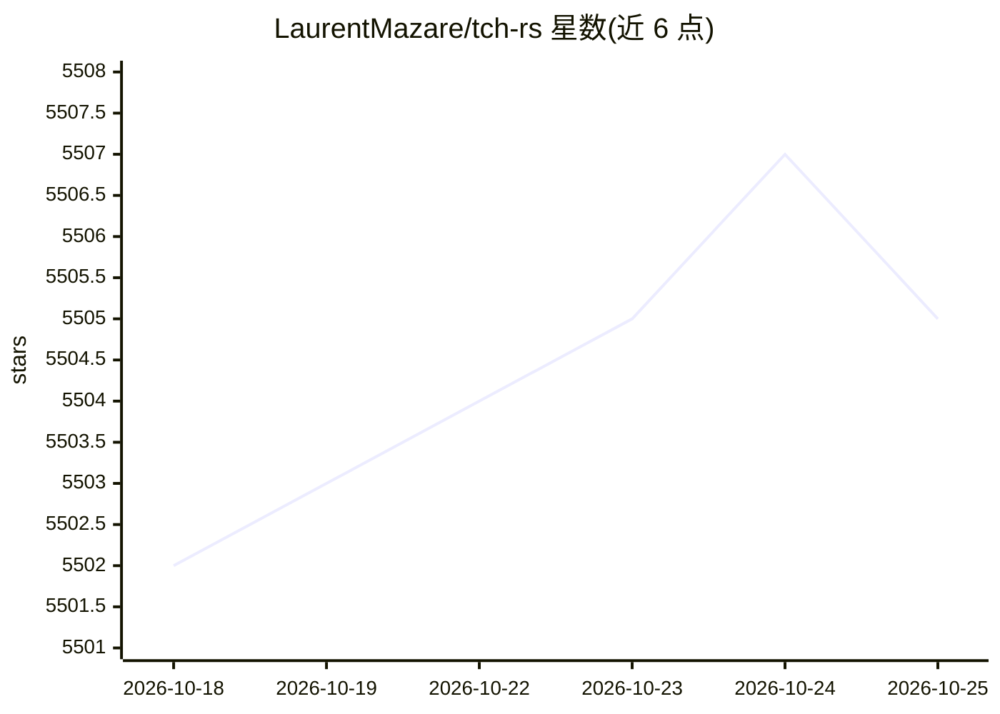

# LaurentMazare/tch-rs

⭐ 5,505 · Rust · Apache-2.0 · 推送 2026-08-23 · [GitHub](https://github.com/LaurentMazare/tch-rs) · 个人维护

**PyTorch C++ API 的 Rust 绑定，供 Rust 开发深度学习**

tch-rs 是围绕 C++ PyTorch API（libtorch）的 Rust 薄封装，接口尽量贴近原始 C++ API。提供 Tensor 类型、nn 模块、VarStore 与 SGD/Adam 优化器，支持自动微分训练；可导入 PyTorch 训练的权重（.ot 文件或 SafeTensors 格式）并用 TorchScript JIT 运行 Python 训练的模型。构建时需系统提供 libtorch v2.13.0，可通过 LIBTORCH 环境变量指定路径、复用 Python PyTorch 安装或由构建脚本下载预编译二进制（CPU 或 CUDA 11.7）。附 MNIST、char-rnn、风格迁移、强化学习、简化版 GPT 与 Stable Diffusion 等示例。

## 筛选速览

| 维度 | 判定 | 备注 |
|---|---|---|
| AI 角色 | `ai-ecosystem` | LLM/agent 周边工具 |
| 许可风险 | `permissive` | Apache-2.0 |
| 部署形态 | `library` | 以包/库形式分发 |
| 模型依赖 | — | README 未给出锁定关系 |
| 硬件要求 | — | 无带数字的原话,不猜 |
| 安装摩擦 | `medium` | 含编译或系统依赖之一 |
| 成熟度 | — | 结构信号不足 |

## 能力要点

- Tensor/nn/VarStore API 与 SGD/Adam 优化器，支持自动微分训练
- 导入 PyTorch 权重（.ot）与 HuggingFace SafeTensors 格式权重
- TorchScript JIT 运行 Python 训练的模型
- libtorch 获取方式多样：系统安装/LIBTORCH 变量/复用 Python 安装/构建脚本自动下载

## 适用场景

- 在 Rust 项目中训练和推理 PyTorch 模型
- 将 Python 训练的模型导出权重后部署到 Rust 环境
- 复现 char-rnn、GPT、Stable Diffusion 等示例进行学习

## 场景标签

 · 领域:深度学习/Rust 库

## 证据(README 行号)

> L2: Rust bindings for the C++ api of PyTorch. The goal of the `tch` crate is to
> L3: provide some thin wrappers around the C++ PyTorch api (a.k.a. libtorch). It

## 星数曲线

2026-10-18 5,502 → 2026-10-25 5,505（+3）

---
*卡片 v1 · prompt 1.4 · 生成 2026-10-20 · 置信度 mid · 依据 README sha `3691f87a1db4` · [字段定义](../../DATASET.md)*
