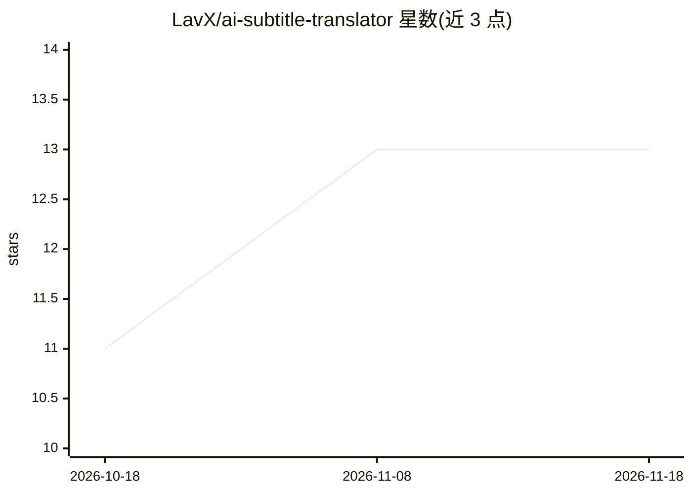

# LavX/ai-subtitle-translator

⭐ 13 · Python · MIT · 推送 2026-11-14 · [GitHub](https://github.com/LavX/ai-subtitle-translator) · 个人维护

**为 Bazarr 打造的 SRT 字幕 LLM 翻译 API 服务**

自托管微服务：接收 SRT 字幕文件，通过 OpenRouter 调用 300+ 模型（Gemini/Claude/Llama/GPT/Mistral 等）完成翻译，输出 SRT。提供异步任务队列、实时进度、费用统计与 Web UI（可选开启）。支持 AES-256-GCM API key 加密与基于共享密钥的认证。面向 Bazarr+ 用户及自建应用的开发者。README 附字幕翻译基准与成本估算示例。

## 筛选速览

| 维度 | 判定 | 备注 |
|---|---|---|
| AI 角色 | `ai-native` | 本体是模型或模型工具 |
| 许可风险 | `permissive` | MIT |
| 部署形态 | `self-host` | docker 或自建部署 |
| 模型依赖 | locked-api |  |
| 硬件要求 | — | 无带数字的原话,不猜 |
| 安装摩擦 | `low` | 无编译、无系统依赖或容器化 |
| 成熟度 | — | 结构信号不足 |

## 能力要点

- 通过 OpenRouter 接入 300+ 模型，支持按请求选择 provider 路由与 SmartFast 过滤策略
- 异步任务队列、实时进度与费用上报，可取消/恢复队列任务
- AES-256-GCM 加密的 API key 传输与密钥派生认证
- 可选 Web UI 支持批量 SRT 翻译、预览对比与 ZIP 打包下载

## 适用场景

- 为 Bazarr/*arr 媒体库自动翻译剧集字幕
- 自托管字幕翻译 API 供自有应用调用
- 用 Web UI 批量翻译 SRT 并追踪成本

## 场景标签

`AI 写作` · 领域:内容生成

## 证据(README 行号)

> L7: Translate SRT files and subtitle lines through OpenRouter. Run the service on your own machine, choose a model, and 
> L14: - **Choose your model.** OpenRouter models with per-request provider routing.

## 星数曲线

2026-10-18 11 → 2026-11-18 13（+2）

---
*卡片 v1 · prompt 1.4 · 生成 2026-11-18 · 置信度 mid · 依据 README sha `581d1738cb1c` · [字段定义](../../DATASET.md)*
