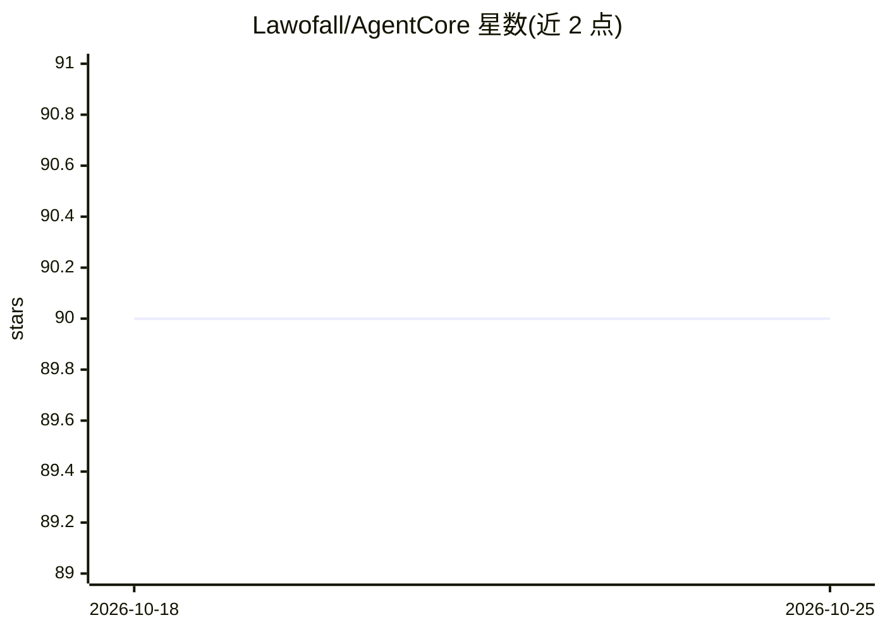

# Lawofall/AgentCore

⭐ 90 · Python · NOASSERTION · 推送 2026-10-24 · [GitHub](https://github.com/Lawofall/AgentCore) · [官网](https://fashitianxia.xyz) · 个人维护 · 中文 README

**面向大众的多 Agent AI 桌面工作台，支持 Agent 团队协作**

AgentCore 是一个 Multi-Agent AI 工作台，定位为面向大众的桌面应用（Electron + FastAPI 技术栈），主打多个 Agent 之间的团队协作，区别于单 Agent 子任务派发模式。提供桌面安装包（发布于独立产物仓 AgentCore-releases），也可 clone 源码本地开发。文档为中文，含设计文档索引。许可采用 FSL-1.1-ALv2：可查看、修改与内部自用，但不得作为竞品对外提供或托管，每个版本满两年后转为 Apache 2.0。

## 筛选速览

| 维度 | 判定 | 备注 |
|---|---|---|
| AI 角色 | `ai-native` | 本体是模型或模型工具 |
| 许可风险 | `none` | NOASSERTION |
| 部署形态 | `None` |  |
| 模型依赖 | — | README 未给出锁定关系 |
| 硬件要求 | — | 无带数字的原话,不猜 |
| 安装摩擦 | `low` | 无编译、无系统依赖或容器化 |
| 成熟度 | — | 结构信号不足 |

## 能力要点

- 多 Agent 协作模式（区别于单 Agent 子任务派发）
- 提供桌面安装包（产物仓 AgentCore-releases）
- 支持 clone 源码本地开发，含设计文档索引

## 适用场景

- 用多个 Agent 组成团队协作完成任务的桌面工作台
- 中文用户本地的多 Agent 工作环境

## 场景标签

`多智能体` `AI 助手` · 领域:Agent 开发

## 证据(README 行号)

> L3: 面向大众的 **Multi-Agent AI 工作台**——真正的 Agent 团队协作，而非「单 Agent + 子任务派发」。
> L5: > A multi-agent AI workspace. Docs are **Chinese**.

## 星数曲线

2026-10-18 90 → 2026-10-25 90（+0）

---
*卡片 v1 · prompt 1.4 · 生成 2026-10-23 · 置信度 low · 依据 README sha `d5f5e302b901` · [字段定义](../../DATASET.md)*
