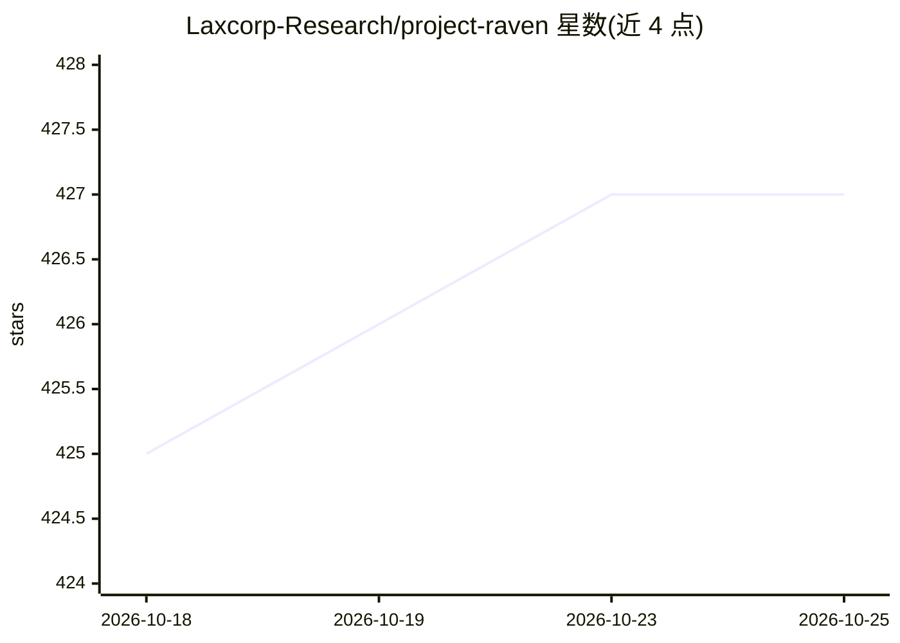

# Laxcorp-Research/project-raven

⭐ 427 · TypeScript · MIT · 推送 2026-09-23 · [GitHub](https://github.com/Laxcorp-Research/project-raven) · 组织维护

**开源本地优先 AI 会议副驾：实时转录+会中提示+会后纪要**

Electron 桌面应用，双流采集系统音频与麦克风，本地经 GStreamer WebRTC AEC3 与残差回声门做回声消除，用 Deepgram nova-3 或 AssemblyAI 双流并行实时转录，并由 Anthropic/OpenAI 提供会中悬浮提示、会后行动项、跟进邮件草稿与跨会议问答。BYOK 模式，录音与笔记存本地 SQLite，文档 RAG 用本地 MiniLM 嵌入；无账号与托管后端。支持 macOS 12+ 与 Windows 10/11，提供预编译安装包，Linux 不支持。

## 筛选速览

| 维度 | 判定 | 备注 |
|---|---|---|
| AI 角色 | `ai-native` | 本体是模型或模型工具 |
| 许可风险 | `permissive` | MIT |
| 部署形态 | `desktop` | 安装包/桌面程序 |
| 模型依赖 | — | README 未给出锁定关系 |
| 硬件要求 | — | 无带数字的原话,不猜 |
| 安装摩擦 | `medium` | 含编译或系统依赖之一 |
| 成熟度 | — | 结构信号不足 |

## 能力要点

- 双流采集+本地 WebRTC AEC3 回声消除，You/Them 分流转录
- BYOK：转录与 AI 均使用用户自有 API key，数据留本地 SQLite
- 会中隐形悬浮提示（对屏幕共享不可见）与会后结构化行动项/邮件草稿
- 按模式本地 RAG（MiniLM 嵌入）与跨会议历史检索问答

## 适用场景

- 会议中实时看到转录并获得 AI 建议的应答提示
- 会后自动生成行动项、跟进邮件草稿与谈话占比
- 在本地检索并问答自己的全部会议历史

## 场景标签

`语音识别` `RAG` · 领域:知识与检索

## 证据(README 行号)

> L15: Raven is an Electron desktop app. It captures microphone and system audio, cancels echo on your machine, transcribe
> L75: - **Real-time transcription** — Two streams: **You** (cleaned mic) and **Them** (system audio). Deepgram `nova-3` a
> L76: - **AI assistance** — Anthropic or OpenAI from the overlay (Assist, recap, follow-up, and custom prompts). Optional

## 星数曲线

2026-10-18 425 → 2026-10-25 427（+2）

---
*卡片 v1 · prompt 1.4 · 生成 2026-10-21 · 置信度 high · 依据 README sha `d40ae7e32706` · [字段定义](../../DATASET.md)*
