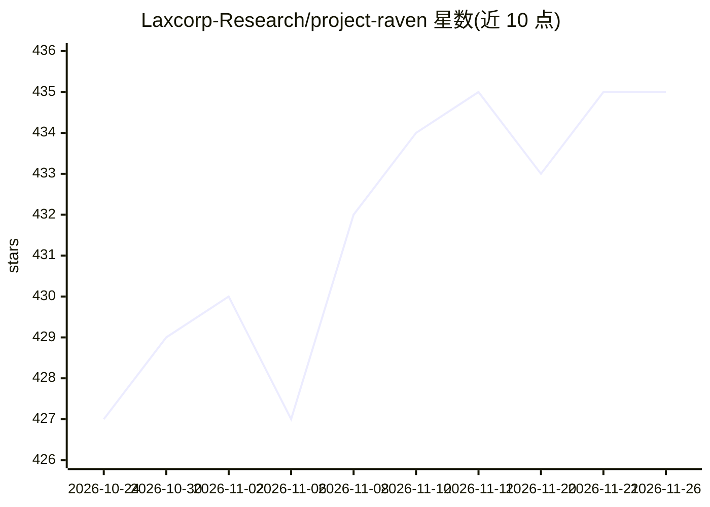

# Laxcorp-Research/project-raven

⭐ 435 · TypeScript · MIT · 推送 2026-11-15 · [GitHub](https://github.com/Laxcorp-Research/project-raven) · 组织维护

**给参会者的本地会议 copilot：实时转写与 AI 助手**

Electron 桌面应用，捕获麦克风与系统音频双流，经 WebRTC AEC3（GStreamer）本地回声消除后，将 You/Them 两路并行送 Deepgram 或 AssemblyAI 实时转写；会议中通过隐形 overlay 调用 Anthropic/OpenAI 提供回答建议，会后生成行动项、跟进邮件草稿、发言占比并导出 Markdown/PDF。数据存于本地 SQLite，支持按模式的本地 RAG（MiniLM 嵌入）与跨会议检索问答。转录与 AI 均需用户自备 API key；不支持 Linux，Intel Mac 需源码构建。

## 筛选速览

| 维度 | 判定 | 备注 |
|---|---|---|
| AI 角色 | `ai-native` | 本体是模型或模型工具 |
| 许可风险 | `permissive` | MIT |
| 部署形态 | `desktop` | 安装包/桌面程序 |
| 模型依赖 | — | README 未给出锁定关系 |
| 硬件要求 | — | 无带数字的原话,不猜 |
| 安装摩擦 | `medium` | 含编译或系统依赖之一 |
| 成熟度 | — | 结构信号不足 |

## 能力要点

- 双流捕获 + WebRTC AEC3 回声消除 + 残余回声门控
- Deepgram nova-3 / AssemblyAI 实时转写，按语言自动路由
- 隐形 overlay（setContentProtection）不进入屏幕共享
- 本地 SQLite 会话存储与设备端 MiniLM 跨会议检索问答

## 适用场景

- 会议中实时获取转录并让 AI 建议如何回应
- 会后自动整理行动项、跟进邮件与会议纪要导出
- 跨历史会议检索提问并引用来源会话
- 销售/面试等场景用本地 RAG 资料辅助应答

## 场景标签

`AI 助手` `语音识别` `RAG` · 领域:对话与助手

## 证据(README 行号)

> L11: - **During the call** — dual-stream capture and an overlay that suggests what to say, invisible to screen share.
> L15: Raven is an Electron desktop app. It captures microphone and system audio, cancels echo on your machine, transcribe
> L17: Capture, echo cancellation, SQLite history, and document RAG run locally. Microphone/system audio goes to **Deepgra

## 星数曲线

2026-10-24 427 → 2026-11-26 435（+8）

---
*卡片 v1 · prompt 1.4 · 生成 2026-11-25 · 置信度 mid · 依据 README sha `fd7a9f9d9970` · [字段定义](../../DATASET.md)*
